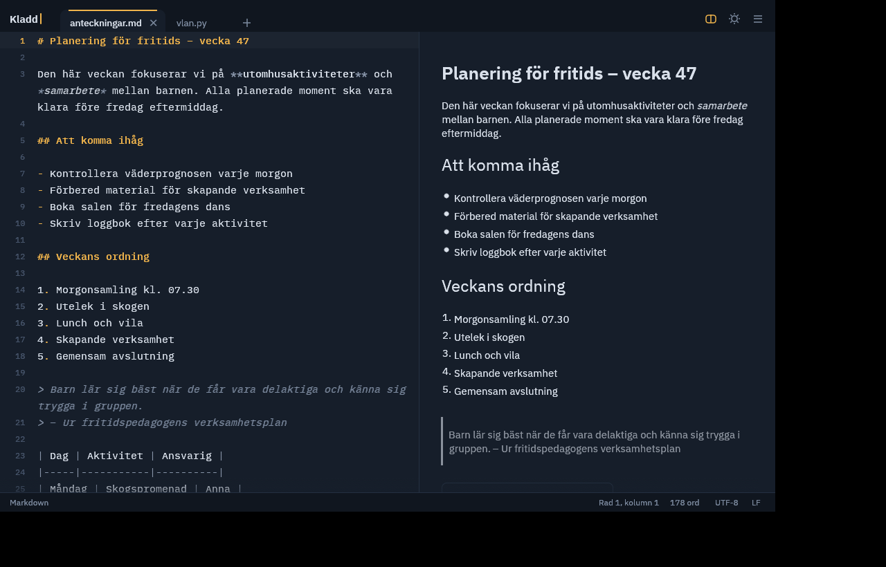
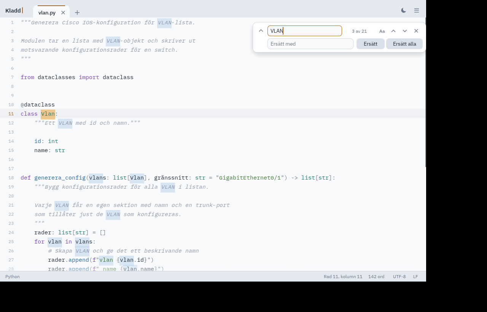
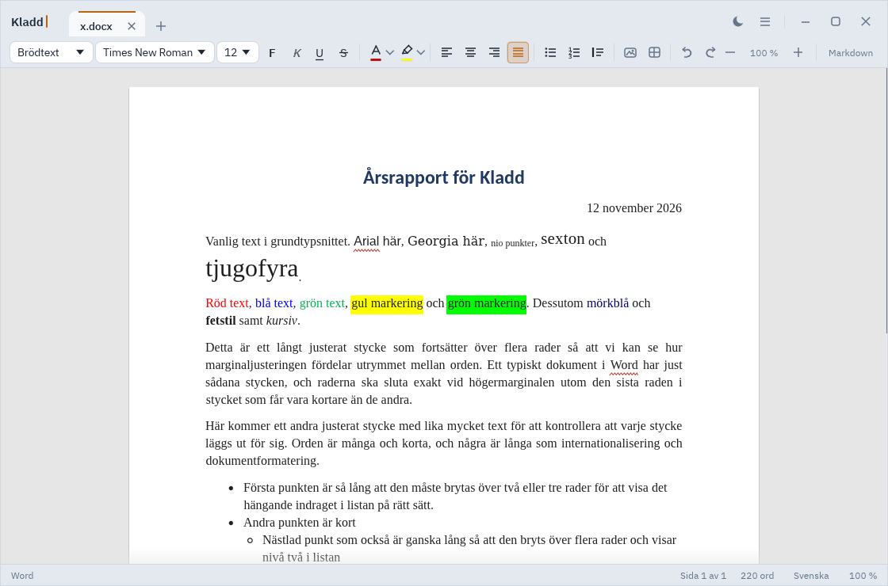

<p align="center">
  
</p>

<h1 align="center">Kladd</h1>

<p align="center">
  <strong>En lugn och snygg texteditor för Linux.</strong><br>
  För anteckningar, Markdown och kod – utan krångel.
</p>

<p align="center">
  
  
</p>

Kladd är en snabb och ren texteditor med flikar, syntaxfärgning, sök och ersätt och en förhandsvisning av Markdown. Den finns i ett mörkt och ett ljust tema och är gjord för att kännas lika hemma i en anteckningsfil som i ett kodprojekt.

| Mörkt tema | Ljust tema |
|---|---|
|  |  |

## Funktioner

- **Flikar** – öppna flera filer samtidigt. `Ctrl+T` skapar en ny flik.
- **Säkerhetskopia och återställning** – osparade flikar sparas undan var 30:e sekund; efter en krasch erbjuder Kladd att återställa dem vid nästa start. Kan stängas av i huvudmenyn.
- **Spara automatiskt** – slå på i huvudmenyn: ändrade filer sparas två sekunder efter att du slutat skriva och när fönstret tappar fokus. Rör aldrig namnlösa flikar, PDF:er eller filer där sparning skulle tappa innehåll, och skriver inte över en fil som ändrats på disk.
- **Versionshistorik** – varje sparning lagrar en version (gallras automatiskt). *Versionshistorik…* i huvudmenyn jämför med aktuell text och kan återställa en version eller öppna den i en ny flik.
- **Öppna och spara** `.txt`, `.md`, Word-dokument (`.docx`), OpenDocument-text (`.odt`), många kodformat och PDF. PDF:er visas i en PDF-visare, se [PDF](#pdf).
- **Utskrift** med `Ctrl+P` till CUPS-skrivare (kopior, sidintervall, dubbelsidigt) eller som PDF. PDF-filen följer dokumentets sidstorlek och marginaler och har sidnummer i sidhuvud och sidfot.
- **Klistra in formaterad text** från Word, LibreOffice, Google Dokument och webbsidor. Ctrl+Shift+V klistrar in utan formatering.
- **Förlustfri Word-sparning** – Word-filer sparas med alla sina delar kvar, se [Word-dokument](#word-dokument).
- **Syntaxfärgning** och radnummer.
- **Sök och ersätt** med `Ctrl+F` och `Ctrl+H`, med alternativ för versaler, hela ord och reguljära uttryck (`$1` och `${namn}` fungerar i ersättningen). I dokumentläget söker Kladd i den synliga texten, så "fet text" hittar `**fet** text`. Du kan också söka på formatering (fetstil, kursiv, färg, markering, rubrik) och låta *Ersätt* lägga på eller ta bort formatering på träffarna.
- **Markdownförhandsvisning** med `Ctrl+Shift+M`.
- **Delad vy** – `Ctrl+\` delar fönstret i två rutor bredvid varandra, `Ctrl+Shift+\` över varandra (eller *Dela vyn* / *Dela vågrätt* i menyn). Välj flik per ruta i rutans egen väljare, eller visa samma dokument två gånger med egen rullning. Dra skiljelinjen för att ändra storleken; `F6` byter aktiv ruta.
- **Navigeringsfönster** med rubrikerna som ett träd (`Ctrl+Shift+O`) och **innehållsförteckning** med sidnummer i dokument, se [Navigering och innehållsförteckning](#navigering-och-innehållsförteckning).
- **Två teman** – *Gryning* och *Skymning*.
- **Teckenkodning** – UTF-8, UTF-16 och Windows-1252, med bevarade radslut.
- **Dra och släpp** filer direkt i fönstret.
- **Ett fönster** – filer som öppnas från filhanteraren eller terminalen läggs som nya flikar i det Kladd-fönster som redan är öppet. Använd `kladd --new-window` för ett separat fönster.
- **Dokumentläge** – Word- och OpenDocument-dokument visas som ett dokument med riktiga sidor, formateringsfält och sidnummer. Se [Word-dokument](#word-dokument).
- **Stavningskontroll** i dokumentläget, med svenska och engelska ordlistor från systemet, eller hämtade i Kladd på Windows och macOS.
- **Uppdateringar** – Kladd kollar högst en gång per dygn på GitHub om det finns en nyare version och visar då ett diskret fält med *Visa nyheter*, *Hämta och installera*, *Senare* och *Hoppa över*. Installationsfilen hämtas för ditt system (Windows-installationsprogram, macOS-skivavbild, .deb eller AppImage) och inget körs förrän du klickar. Kontrollen kan stängas av i huvudmenyn, och *Sök efter uppdateringar* kontrollerar direkt.

## Kom igång

Ladda ner det senaste paketet för ditt system från [Releases](https://github.com/felixarvid2/kladd-text-editor/releases/latest).

**Linux (Ubuntu/Debian)** – installera `.deb`-paketet:

```bash
sudo apt install ./kladd_*.deb
```

**Linux (alla distributioner)** – hämta `Kladd-<version>-x86_64.AppImage`, gör den körbar och starta den:

```bash
chmod +x Kladd-*-x86_64.AppImage
./Kladd-*-x86_64.AppImage
```

(Saknar systemet FUSE kan du köra `./Kladd-*-x86_64.AppImage --appimage-extract-and-run`.)

**Windows** – kör `Kladd-<version>-windows-x64-setup.exe`. Installationen sker för din användare och kräver inte administratör (dialogen låter dig välja installation för alla). Du kan lägga till en genväg på skrivbordet och låta Kladd synas under *Öppna med* för `.docx`, `.odt`, `.md` och `.txt`. Vill du slippa installera finns även `Kladd-<version>-windows-x64.zip`: packa upp och kör `kladd.exe`. Programmet är inte signerat, så Windows SmartScreen varnar vid första starten: välj *Mer information* och sedan *Kör ändå*.

**macOS** (11 eller nyare, Apple Silicon och Intel) – öppna `Kladd-<version>-macos-universal.dmg` och dra Kladd till mappen Program. Programmet är inte notariserat, så första gången måste du högerklicka på Kladd och välja *Öppna* (och bekräfta). Alternativt tar du bort karantänmärkningen i Terminalen:

```bash
xattr -dr com.apple.quarantine /Applications/Kladd.app
```

På macOS öppnas filer från Finder i Kladd: *Öppna med*, dubbelklick (efter *Hämta info* → *Öppna med* → *Ändra alla…*) och att dra filer till ikonen i Dock. De läggs som nya flikar i det öppna fönstret. Kladd är bara ett alternativ i *Öppna med* och tar inte över någon filtyp av sig själv.

**Signering:** just nu är varken Windows- eller macOS-paketen signerade (därav varningarna ovan) och AppImagen är osignerad. Release-workflowen kan signera och notarisera så fort certifikat finns, se [docs/dev/signering.md](docs/dev/signering.md).

Nyheter i varje version står i [CHANGELOG.md](CHANGELOG.md).

Du kan också bygga Kladd från källkoden:

```bash
cargo build --release
./target/release/kladd
```

<details>
<summary>Bygg ett .deb-paket</summary>

```bash
cargo install cargo-deb --locked   # en gång
cargo deb                          # skapar paketet i target/debian/
```

Avinstallera med `sudo apt remove kladd`.

En ny release skapas automatiskt när en versionstagg pushas. Höj först `version` i `Cargo.toml`, och tagga sedan samma version:

```bash
git tag v1.4.0
git push origin v1.4.0
```

Det går också att köra workflowen *Release* för hand under Actions och kryssa i *Publicera release*. Då skapas taggen från versionen i `Cargo.toml`.

Release-anteckningarna hämtas från avsnittet för versionen i `CHANGELOG.md`; finns inget avsnitt skapas anteckningarna automatiskt. Skriv anteckningarna i `CHANGELOG.md` innan du taggar. För en redan publicerad release: kör workflowen för hand, fyll i *update_notes* med taggen (till exempel `v1.5.0`) och lämna *Publicera release* ikryssad av. Då byts bara anteckningarna ut.

</details>

## Word-dokument

Kladd öppnar `.docx` och `.odt` (LibreOffice) i dokumentläge, som liknar ett Word-dokument. När du sparar som `.docx` blir det ett riktigt Word-dokument som öppnas i Word, LibreOffice och Google Dokument. `.odt` sparas som OpenDocument-text. Med *Spara som* kan vilken flik som helst sparas som `.docx`.

### Dokumentläge



Ett öppnat `.docx` visas på vita sidor mot grå bakgrund, med sidstorlek och marginaler från dokumentet och typografi som liknar Word. Dokumentets typsnitt, storlekar, färger, markeringar och styckejustering (vänster, centrerat, höger och marginaljustering) visas som i Word. Typsnitten hämtas från systemet precis som i LibreOffice, så Arial visas med Liberation Sans och Times New Roman med Liberation Serif. Calibri visas med Carlito, som har samma mått. Listor dras in med hängande indrag, tabeller ritas som rutnät med celler som bryter långa rader, `Enter` för radbrytning i cellen, sammanfogade celler och kolumnbredder som du ändrar genom att dra i kanten, och bilder visas i texten. Markdown-koden är dold; den visas nedtonad bara på raden där markören står. Fotnoter visas som små upphöjda siffror med texten under en skiljelinje sist i dokumentet: *Infoga fotnot* i verktygsraden (`Ctrl+Alt+F`) lägger till en och numrerar om, Ctrl+klick på ett nummer hoppar mellan referensen och fotnoten, och fotnoterna följer med som riktiga fotnoter när du sparar som `.docx` eller `.odt` och hamnar längst ned på sidan i PDF.

Formateringsfältet ovanför texten har stilval (Brödtext, Rubrik 1–3, Citat), typsnitt och storlek, textfärg och markeringsfärg, vänster-, center-, höger- och marginaljustering, knapparna F, K, U och S för fet, kursiv, understruken och genomstruken, punktlista, numrerad lista, citat, menyn *Infoga* (bild, tabell, fotnot och innehållsförteckning), ångra och gör om, sidinställningar samt zoom. Statusfältet visar "Sida x av y", antal ord, språk för stavningskontrollen och zoomnivå.

### Förlustfri sparning

Kladd behåller alla delar av originalfilen, som sidhuvud, sidfot, fotnoter, kommentarer, teman och inställningar. Vid sparning skrivs bara de stycken om som du har ändrat; oförändrade stycken sparas exakt som de var. Objekt som Kladd inte kan visa, till exempel fotnotsreferenser, kommentarer, fält och textrutor, blir osynliga markörer `<!--k:N-->` i Markdown-texten och skrivs tillbaka när du sparar. Det enda som kan försvinna är spårade ändringar i stycken som du ändrar.

### Navigering och innehållsförteckning

Navigeringsfönstret (`Ctrl+Shift+O`, knappen längst upp till höger eller *Navigeringsfönster* i menyn) visar rubrikerna i Word-, ODT-, PDF- och Markdown-flikar, i både dokumentläge och textläge. Klicka på en rubrik för att flytta markören dit; pilen fäller ihop underrubriker och fältet *Sök i rubriker* filtrerar listan.

*Infoga → Innehållsförteckning* (i formateringsfältet eller huvudmenyn) sätter in raden `<!-- kladd: toc -->` vid markören. I dokumentläget visas rubrikerna H1–H3 med sidnummer; klicka på en post för att hoppa dit. Står markören på raden visas själva kommentaren. Sparas dokumentet som `.docx` blir det ett innehållsförteckningsfält som Word uppdaterar när filen öppnas (Word frågar då om fälten ska uppdateras), som `.odt` en `text:table-of-content` och som PDF en förteckning med riktiga sidnummer och länkar. Förteckningar som redan finns i ett öppnat Word- eller OpenDocument-dokument visas som samma rad.

### Sidor och utskrift

Knappen *Sidinställningar* (eller dubbelklick på sidhuvud eller sidfot) öppnar en dialog för sidstorlek (A4, A5, A3, Letter, Legal), stående eller liggande, marginaler, sidhuvud och sidfot. I sidhuvud och sidfot betyder `{sida}` och `{sidor}` sidnummer och antal sidor, `{datum}` dagens datum (ÅÅÅÅ-MM-DD), `{titel}` filnamnet utan ändelse och `{fil}` hela filnamnet. Med `|` delas texten i vänster, mitten och höger (`header: "Rapport|{titel}|{sida}"`), och `header-first`/`footer-first` ger första sidan eget sidhuvud och sidfot (`""` = tom). Dubbelklick på sidhuvudet eller sidfoten på en sida öppnar *Sidhuvud och sidfot* med tre fält, knappar som infogar fält och rutan *Annorlunda första sida*. Fälten följer med till PDF, utskrift, `.docx` (PAGE, NUMPAGES, DATE, TITLE, FILENAME) och `.odt`, och läses från Word- och LibreOffice-dokument med enkel vänster/mitten/höger-layout med flikar. Inställningarna sparas i grundformatskommentaren:

```
<!-- kladd: page-size: A4; page-margin: 25mm; footer: "Sida {sida} av {sidor}"; footer-align: center -->
```

### Tabeller, bilder och inklistring

Tabeller redigeras direkt i rutnätet. Tab och Shift+Tab flyttar mellan cellerna, och Tab i sista cellen lägger till en rad. När markören står i en tabell visar formateringsfältet knappar för att lägga till och ta bort rader och kolumner eller hela tabellen. Samma funktioner finns i högerklicksmenyn.

Klicka på en bild för att markera den. Dra i hörnen för att ändra storlek (håll Skift för fri proportion) eller dra i själva bilden för att flytta den: en linje visar var den hamnar, och Esc avbryter. En liten verktygsrad vid bilden justerar läget (vänster, centrerat eller höger), väljer radbrytning (*I texten*, eller *Vänster*/*Höger* så att texten flyter runt bilden), återställer originalstorleken eller tar bort bilden. Delete tar bort en markerad bild. Flytande bilder sparas som förankrade bilder med textomflöde i Word och LibreOffice.

Ctrl+V klistrar in formaterad text med rubriker, fetstil, kursiv, understrykning, färger, typsnitt, storlekar, justering, listor, tabeller, länkar och inbäddade bilder. Ctrl+Shift+V klistrar in oformaterad text.

Vill du se dokumentet som vanlig Markdown-text klickar du på *Markdown* i formateringsfältet. Klicka på *Visa som dokument* i statusfältet för att gå tillbaka.

### Stavningskontroll

I dokumentläget markeras felstavade ord med ett rött vågigt understreck medan du skriver. Högerklicka på ett ord för att se förslag, välja *Ignorera alla* eller *Lägg till i ordlistan*. Tillagda ord sparas i `~/.config/kladd/ordlista.txt` (på Windows och macOS i `ordlista.txt` i Kladds mapp, se nedan).

Kladd använder Hunspell-ordlistor (`.aff` och `.dic`). Språk och på/av väljer du genom att klicka på språket i statusfältet. Standardspråket är svenska när det är installerat, annars systemets språk (`$LANG` eller operativsystemets inställning).

- **Linux:** ordlistorna i `/usr/share/hunspell`, samma som LibreOffice använder på Ubuntu. Installera svenska med `sudo apt install hunspell-sv`; .deb-paketet föreslår `hunspell-sv` och `hunspell-en-us`.
- **Windows och macOS:** det finns inga ordlistor i systemet, så Kladd erbjuder att hämta dem. Finns ingen ordlista visar statusfältet *Ingen ordlista*; klicka där och välj *Hämta svensk ordlista* (eller *Hämta fler språk…* för engelska, norska, danska, tyska, franska och spanska). Kladd hämtar `.aff`- och `.dic`-filerna från [LibreOffices ordlistearkiv](https://github.com/LibreOffice/dictionaries) i bakgrunden och väljer språket när det är klart. Ordlistan har egen licens (LGPL/MPL …); licenstexten sparas bredvid den. Hämtningen följer `HTTPS_PROXY`. Ordlistorna hamnar i `~/Library/Application Support/Kladd/ordlistor` (macOS) respektive `%APPDATA%\Kladd\ordlistor` (Windows). Är LibreOffice installerat används dess ordlistor också, liksom `/Library/Spelling` och `~/Library/Spelling` på macOS.

Ordlistor i mappen som `$DICPATH` pekar på hittas på alla system.

### Grammatik och stil

Grammatikkontrollen använder [LanguageTool](https://languagetool.org/http-api/) och är **av som standard**. Klicka på *Grammatik* i statusfältet (eller välj *Grammatik* i menyn bakom språket) för att slå på den och välja server: *LanguageTools server (api.languagetool.org)* eller en egen adress, till exempel `http://localhost:8081` för en lokalt installerad LanguageTool. Med den publika servern skickas texten du skriver över internet; det förklaras en gång innan funktionen slås på. Språket följer stavningsspråket (annars väljer servern automatiskt).

Bara synlig text skickas, utan Markdown-syntax, och bara stycken som ändrats, ungefär 1,5 sekunder efter att du slutat skriva. Kladd håller sig inom den publika serverns gränser (20 anrop per minut, 20 kB per anrop). Grammatikfel markeras med blått och stilråd med bärnstensgult vågigt understreck. Håll pekaren över ett understreck för förklaringen, eller högerklicka för upp till fem förslag, *Ignorera* och *Ignorera regeln* (gäller sessionen). Statusfältet visar antalet träffar. Stavning kontrolleras fortfarande av Hunspell.

| I Word | I Kladd |
|---|---|
| Rubriker och titel | `#` … `######` |
| Fetstil, kursiv, understruken, genomstruken | `**fet**`, `*kursiv*`, `<u>understruken</u>`, `~~struken~~` |
| Typsnitt, storlek, textfärg, markering | `<span style="font-family: Arial; font-size: 14pt; color: #C00000; background-color: #FFFF00">…</span>` |
| Centrerat, högerjusterat, marginaljusterat | `<div align="center">` … `</div>` |
| Dokumentets grundtypsnitt | `<!-- kladd: font-family: "Times New Roman"; font-size: 12pt -->` på första raden |
| Sidstorlek, marginaler, sidhuvud och sidfot | Samma kommentar: `page-size: A4; page-margin: 25mm; footer: "Sida {sida} av {sidor}"` |
| Fotnoter, kommentarer, fält, textrutor m.m. | `<!--k:N-->` (osynlig markör, skrivs tillbaka vid sparning) |
| Punktlistor och numrerade listor | `-` och `1.` |
| Citat | `>` |
| Tabeller | `\| kolumn \| kolumn \|` |
| Länkar | `[text](https://…)` |
| Kod | `` `kod` `` och kodblock |
| Bilder (PNG, JPEG, GIF, BMP) | `` |
| Bildstorlek | `` |

Bilder i dokumentet följer med när du sparar och syns i förhandsvisningen. Lägg till egna bilder med *Infoga bild…* (`Ctrl+Shift+I`), genom att dra in en bildfil i fönstret eller genom att skriva ``. Sökvägen kan vara relativ till dokumentet. När dokumentet sparas som `.docx` bäddas bilderna in. Sparar du ett Word-dokument som Markdown hamnar bilderna i en mapp bredvid filen.

Diagram, former, textrutor, kommentarer, fotnoter och sidhuvuden visas inte i texten, men de bevaras när filen sparas (se [Förlustfri sparning](#förlustfri-sparning)). Kladd frågar innan originalet skrivs över. Lösenordsskyddade filer och det gamla `.doc`-formatet stöds inte.

Läsning och skrivning bygger på samma teknik som [WordCraft](https://github.com/storytold/wordcraft) (MIT/Apache-2.0).

## PDF

En PDF öppnas i en PDF-visare som visar sidorna som de ser ut. Sidorna renderas med [hayro](https://github.com/LaurenzV/hayro) i bakgrundstrådar, så gränssnittet inte fryser, och de är skarpa på HiDPI-skärmar. Sidorna ligger på vita ark mot en grå bakgrund med kontinuerlig rullning. Zoomen har lägena Automatisk, Verklig storlek, Hel sida och Sidbredd, och går från 10 till 2500 %. Du kan visa en sida eller två sidor åt gången, rotera sidorna och välja färgläge (normala, inverterade eller sepia). Sida, zoom och rotation sparas per fil. PDF:er som visaren inte kan läsa öppnas som text, som förut.

| Kommando | Funktion |
|---|---|
| `F4` | Sidopanel med miniatyrer och innehållsförteckning |
| `Ctrl+F` | Sök i hela dokumentet |
| `Ctrl+G` | Gå till sida |
| `F5` | Presentationsläge (Esc avslutar) |
| `R` / `Shift+R` | Rotera |
| `H` | Handverktyg |
| `Ctrl++` / `Ctrl+-` / `Ctrl+0` | Zooma in / ut / 100 % |
| `Ctrl+1` / `Ctrl+2` / `Ctrl+3` | Verklig storlek / sidbredd / hel sida |
| `Alt+Vänster` / `Alt+Höger` | Bakåt / framåt i historiken efter länkar och hopp |

**Ordna sidor.** Klicka, Ctrl+klicka eller Skift+klicka på miniatyrerna för att markera sidor och dra dem för att flytta (en linje visar var de hamnar). Högerklicka för *Rotera åt höger/vänster*, *Ta bort* (eller Delete), *Extrahera till ny PDF…* och *Infoga PDF före/efter…*; *Slå ihop med PDF…* i Visa-menyn lägger till en fil sist. Ändringarna görs direkt i minnet och kan ångras med `Ctrl+Z` och göras om med `Ctrl+Shift+Z`. Fliken blir ändrad; `Ctrl+S` sparar över originalet (atomiskt) och *Spara kopia…* sparar under nytt namn. Typsnitt och bilder följer med sidorna, men bokmärken i en infogad fil tas inte med och en lösenordsskyddad PDF sparas utan lösenord. Mellanslag+dra panorerar som handverktyget.

**Redigera** gör om PDF:en till ett redigerbart dokument, som öppnas i dokumentläget. Kladd läser texten och visar den med rubriker, stycken, punkt- och numrerade listor, tabeller, fetstil, kursiv och bilder. Läsordningen följer spalterna, avstavning vid radslut tas bort, sidnummer i sidhuvud och sidfot hoppas över och stycken som fortsätter på nästa sida fogas ihop. Lösenordsskyddade PDF:er öppnas efter att du skrivit lösenordet. Originalet ändras inte förrän du sparar.

Spara som `.pdf` för att få en A4-PDF med inbäddade typsnitt (IBM Plex), sökbar text, klickbara länkar, bokmärken från rubrikerna, bilder och sidnummer.

En PDF är byggd för utskrift, inte för redigering. När du sparar en PDF som har gjorts om med *Redigera* skapar Kladd därför en ny PDF av texten, och originalets sidlayout och typsnitt ersätts. Kladd frågar innan originalet skrivs över. Sidor som bara består av bilder (skannade sidor) har ingen text att läsa; Kladd säger till när det gäller.

Läsningen bygger på samma metoder som [PdfCraft](https://github.com/storytold/pdfcraft) och skrivningen på samma upplägg som [WordCraft](https://github.com/storytold/wordcraft) (båda MIT/Apache-2.0), med [lopdf](https://crates.io/crates/lopdf) och [krilla](https://crates.io/crates/krilla). Sidorna i PDF-visaren renderas med [hayro](https://github.com/LaurenzV/hayro) (MIT/Apache-2.0).

## Kortkommandon

På Mac används ⌘ i stället för Ctrl och ⌥ i stället för Alt.

| Kommando | Funktion |
|---|---|
| `Ctrl+T` / `Ctrl+N` | Ny flik |
| `Ctrl+O` | Öppna fil |
| `Ctrl+S` | Spara |
| `Ctrl+Shift+S` | Spara som |
| `Ctrl+P` | Skriv ut (alla flikar) |
| `Ctrl+Shift+V` | Klistra in oformaterat (endast dokumentläge) |
| `Tab` / `Shift+Tab` | Nästa / föregående cell i tabell (endast dokumentläge) |
| `Delete` | Ta bort markerad bild (endast dokumentläge) |
| `Ctrl+W` | Stäng flik |
| `Ctrl+Tab` / `Ctrl+Shift+Tab` | Nästa / föregående flik |
| `Ctrl+Shift+I` | Infoga bild |
| `Ctrl+F` / `Ctrl+H` | Sök / ersätt |
| `F3` / `Shift+F3` | Nästa / föregående träff |
| `Esc` | Stäng sökning |
| `Ctrl++` / `Ctrl+-` / `Ctrl+0` | Textstorlek (i dokumentläge: zoom av sidan) |
| `Ctrl+Scroll` | Zoom (endast dokumentläge) |
| `Ctrl+B` / `Ctrl+I` / `Ctrl+U` | Fet / kursiv / understruken (endast dokumentläge) |
| `Ctrl+Alt+1` / `Ctrl+Alt+2` / `Ctrl+Alt+3` | Rubrik 1 / 2 / 3 (endast dokumentläge) |
| `Ctrl+Alt+0` | Brödtext (endast dokumentläge) |
| `Ctrl+L` / `Ctrl+E` / `Ctrl+R` / `Ctrl+J` | Vänster-, center-, höger- och marginaljustera (endast dokumentläge) |
| `Ctrl+Shift+>` / `Ctrl+Shift+<` (eller `Ctrl+]` / `Ctrl+[`) | Större / mindre text, ett steg (endast dokumentläge) |
| `Alt+Z` | Radbrytning på/av |
| `Ctrl+Shift+M` | Markdownförhandsvisning |
| `Ctrl+\` | Dela vyn i två rutor |
| `Ctrl+Shift+\` | Dela vyn vågrätt |
| `F6` | Byt aktiv ruta i delad vy |
| `Ctrl+Shift+O` | Navigeringsfönster (rubrikträd) på/av |
| `Ctrl+D` | Lägg till nästa förekomst av markeringen (eller ordet vid markören) som egen markör (textläge) |
| `Ctrl+Shift+L` | Markera alla förekomster (textläge) |
| `Alt+klick` | Lägg till en markör (textläge) |
| `Alt+Shift+drag` eller mittenknappen | Kolumnmarkering: en markering per rad (textläge) |
| `Esc` | Tillbaka till en markör (textläge, med flera markörer) |
| `Ctrl+Shift+K` | Byt tema |
| `Ctrl+Q` | Avsluta |

## Licens

Kladd är licensierat under MIT, se [LICENSE](LICENSE). Typsnitten IBM Plex Sans och IBM Plex Mono används under SIL Open Font License.

Typsnittet Carlito (metriskt lika Calibri) används för dokumentläget under SIL Open Font License.
