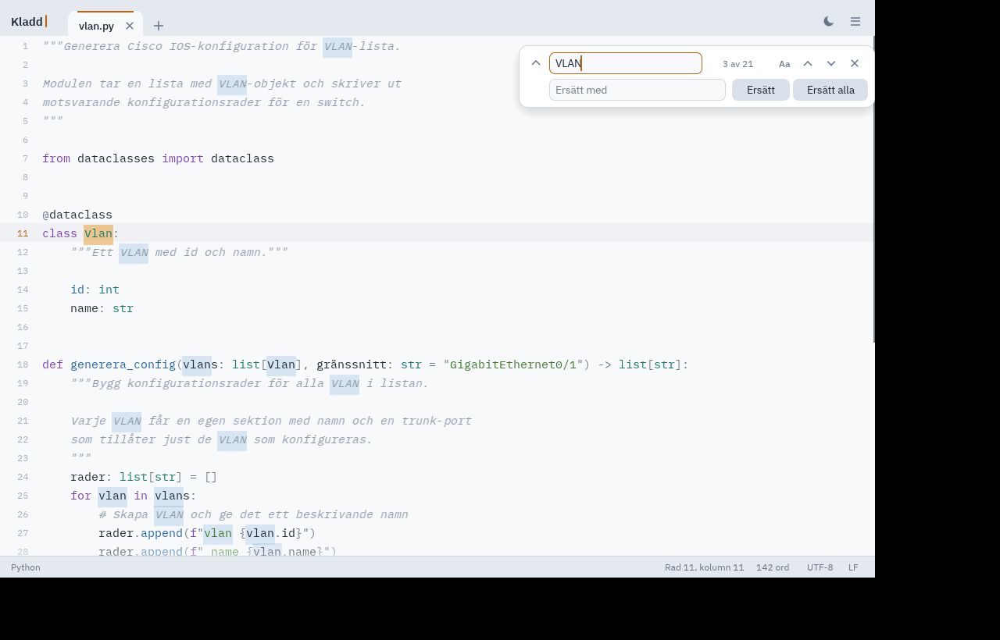

  

<h1 align="center">Kladd</h1>

  <strong>En lugn och snygg texteditor för Linux, Windows och macOS.</strong> 
  För anteckningar, Markdown, Word-dokument, PDF och kod.

  
  

| Mörkt tema | Ljust tema |
|---|---|
|  |  |

Kladd har flikar, syntaxfärgning, sök och ersätt, delad vy, Git, språkservrar och ett Vim-läge för kod. Word- och
LibreOffice-dokument visas med riktiga sidor i ett dokumentläge, och PDF:er i en egen visare. Gränssnittet finns på
svenska och engelska. Allt beskrivs i [handboken](docs/handbok.md).

## Filformat

| Format | Filändelser | Öppna | Spara | Så visas filen |
|---|---|:-:|:-:|---|
| Text | `.txt`, `.log` m.fl. | ✓ | ✓ | Textredigerare |
| Markdown | `.md`, `.markdown` | ✓ | ✓ | Läsläge, *Redigera* byter till texten |
| Word | `.docx` | ✓ | ✓ | Dokumentläge med sidor |
| Word-mallar och makrofiler | `.dotx`, `.docm`, `.dotm` | ✓ | som `.docx` | Dokumentläge |
| OpenDocument-text (LibreOffice) | `.odt` | ✓ | ✓ | Dokumentläge med sidor |
| OpenDocument-mall | `.ott` | ✓ | som `.odt` | Dokumentläge |
| PDF | `.pdf` | ✓ | ✓ | PDF-visare; *Redigera* gör om den till ett dokument |
| CSV och TSV | `.csv`, `.tsv` | ✓ | ✓ | Tabellvy |
| Kod och konfiguration | `.rs`, `.py`, `.js`, `.ts`, `.go`, `.c`, `.cpp`, `.java`, `.html`, `.css`, `.json`, `.toml`, `.yaml`, `.xml`, `.sh`, `.sql` m.fl. | ✓ | ✓ | Textredigerare med färgning |
| Webbsida | `.html` | | export | Från Markdown och dokument |
| E-bok | `.epub` | | export | Från Markdown och dokument |

- **Word och OpenDocument** sparas förlustfritt: det Kladd inte ändrat skrivs tillbaka som det var. Formatmallar,
  tabeller, bilder, spalter, textrutor, sidhuvud och sidfot, fotnoter, slutnoter, kommentarer och spårade
  ändringar följer med.
- **PDF**: sidor kan ordnas, roteras och slås ihop, formulär fyllas i och anteckningar läggas till. Sparningen ändrar
  inte resten av filen.
- **Det gamla `.doc`-formatet stöds inte.** Spara om filen som `.docx` i Word eller LibreOffice.
- **Teckenkodning**: UTF-8, UTF-16 och Windows-1252. Radsluten (LF eller CRLF) bevaras.
- **Bilder** (`.png`, `.jpg`, `.gif`, `.bmp`) kan infogas i dokument.

## Installera

Hämta paketet för ditt system från [Releases](https://github.com/felixarvid2/kladd-text-editor/releases/latest):

- **Linux**: `sudo apt install ./kladd_*.deb`, eller kör AppImagen efter `chmod +x Kladd-*-x86_64.AppImage`.
- **Windows**: kör `Kladd-<version>-windows-x64-setup.exe`, eller packa upp zip-filen. SmartScreen varnar eftersom
  programmet inte är signerat: välj *Mer information* och *Kör ändå*.
- **macOS 11+**: öppna dmg-filen och dra Kladd till Program. Första gången: högerklicka på Kladd och välj *Öppna*.

Bygg från källkoden med `cargo build --release`. Nyheterna står i [CHANGELOG.md](CHANGELOG.md).

## Vanliga kortkommandon

På Mac används ⌘ i stället för Ctrl. `Ctrl+Shift+P` öppnar kommandopaletten, där alla kommandon finns. Hela listan
står i [handboken](docs/handbok.md#kortkommandon).

| Kommando | Funktion |
|---|---|
| `Ctrl+N` / `Ctrl+O` / `Ctrl+S` | Ny flik / öppna / spara |
| `Ctrl+F` / `Ctrl+H` | Sök / ersätt |
| `Ctrl+Shift+M` | Byt mellan läsläge och redigering för Markdown |
| `Ctrl+\` | Dela vyn |
| `Ctrl+E` / `Ctrl+Shift+F` | Snabböppna / sök i filer |
| `Ctrl+P` | Skriv ut |
| `Ctrl+,` | Inställningar |

## Licens

Kladd är licensierat under MIT, se [LICENSE](LICENSE). Typsnitten IBM Plex Sans och IBM Plex Mono används under SIL Open Font License.

Typsnittet Carlito (metriskt lika Calibri) används för dokumentläget under SIL Open Font License.
