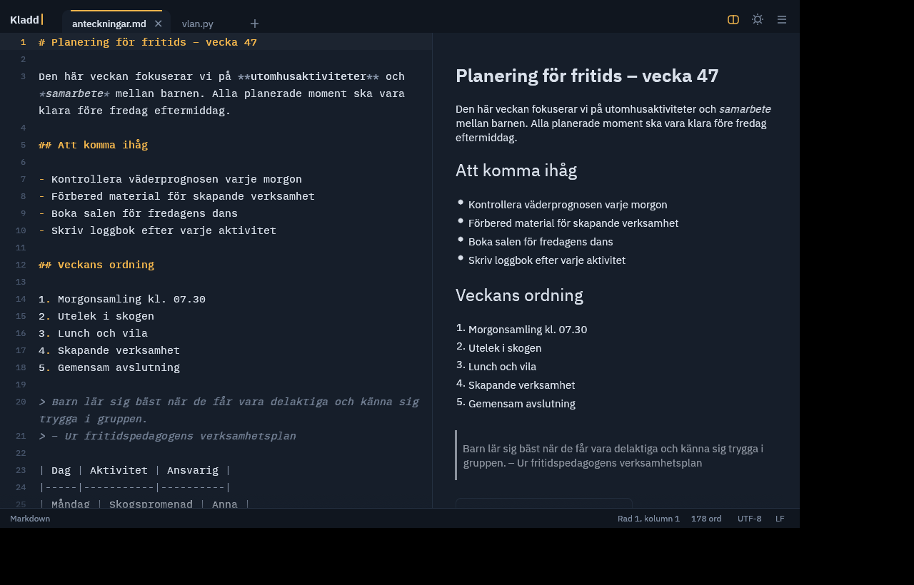

  

<h1 align="center">Kladd</h1>

  <strong>En lugn och snygg texteditor för Linux, Windows och macOS.</strong> 
  För anteckningar, Markdown, Word-dokument, PDF och kod.

  
  

| Mörkt tema | Ljust tema |
|---|---|
|  |  |

Kladd har flikar, syntaxfärgning, sök och ersätt, delad vy, Git, språkservrar och ett Vim-läge för kod. Word- och
LibreOffice-dokument visas med riktiga sidor i ett dokumentläge, PDF:er i en egen visare och e-böcker (`.epub`) i ett läsläge. Gränssnittet finns på
svenska och engelska. Allt beskrivs i [handboken](docs/handbok.md).

## Filformat

| Format | Filändelser | Öppna | Spara | Så visas filen |
|---|---|:-:|:-:|---|
| Text | `.txt`, `.log` m.fl. | ✓ | ✓ | Textredigerare |
| Markdown | `.md`, `.markdown` | ✓ | ✓ | Läsläge, *Redigera* byter till texten |
| Word | `.docx` | ✓ | ✓ | Dokumentläge med sidor |
| Word-mallar och makrofiler | `.dotx`, `.docm`, `.dotm` | ✓ | som `.docx` | Dokumentläge |
| Äldre dokument | `.doc`, `.rtf`, `.wpd`, `.wps` | ✓ via LibreOffice | *Spara som* `.docx` | Konverteras vid öppning, sedan dokumentläge |
| OpenDocument-text (LibreOffice) | `.odt` | ✓ | ✓ | Dokumentläge med sidor |
| OpenDocument-mall | `.ott` | ✓ | som `.odt` | Dokumentläge |
| PDF | `.pdf` | ✓ | ✓ | PDF-visare; *Redigera* gör om den till ett dokument |
| CSV och TSV | `.csv`, `.tsv` | ✓ | ✓ | Tabellvy |
| Kod och konfiguration | `.rs`, `.py`, `.js`, `.ts`, `.go`, `.c`, `.cpp`, `.java`, `.html`, `.css`, `.json`, `.toml`, `.yaml`, `.xml`, `.sh`, `.sql` m.fl. | ✓ | ✓ | Textredigerare med färgning |
| Webbsida | `.html` | | export | Från Markdown och dokument |
| E-bok | `.epub` | ✓ läsläge | export | Läsläge (bara läsning), *Redigera en kopia* ger ett nytt dokument; export från Markdown och dokument |
| PowerPoint | `.pptx`, `.ppsx`, `.potx`, `.pptm`, `.ppt` (via LibreOffice) | ✓ visning | PDF | Miniatyrer, bildspel, anteckningar och sök (bara visning); *Redigera en kopia* ger ett nytt dokument |

- **Word och OpenDocument** sparas förlustfritt: det Kladd inte ändrat skrivs tillbaka som det var. Formatmallar,
  tabeller, bilder, spalter, textrutor, sidhuvud och sidfot, fotnoter, slutnoter, kommentarer och spårade
  ändringar följer med.
- **EPUB**: e-böcker öppnas bara för läsning, med innehållsförteckning, sök i hela boken, fotnoter i en ruta, framstegslinje och typografi (storlek, typsnitt, radavstånd, spaltbredd, ljus, sepia eller mörk sida). Kopieringsskyddade (DRM) böcker öppnas inte.
- **PowerPoint**: presentationer visas bild för bild med Kladds egen ritmotor (former, bilder, text med PowerPoints
  radavstånd och autoanpassning, tabeller och SmartArt), med miniatyrlist, rullande lista, zoom, talaranteckningar,
  sök i bildtext och anteckningar (träffarna markeras på bilden), bildspel i helskärm (`F5`/`Skift+F5`), export till
  PDF och utskrift. *Redigera en kopia* gör presentationens text till ett nytt dokument. Läget sparas per fil.
- **PDF**: sidor kan ordnas, roteras och slås ihop, formulär fyllas i och anteckningar läggas till. Sparningen ändrar
  inte resten av filen.
- **`.doc`, `.rtf`, `.wpd` och `.wps`** konverteras till `.docx` med LibreOffice när du öppnar dem (LibreOffice måste vara installerat). Originalet skrivs aldrig över: *Spara* frågar efter ett nytt `.docx`-namn. Utan LibreOffice öppnas `.rtf` med en enkel inbyggd läsare (text, fet, kursiv, stycken); övriga ger ett felmeddelande.
- **Teckenkodning**: UTF-8, UTF-16 och Windows-1252. Radsluten (LF eller CRLF) bevaras.
- **Bilder** (`.png`, `.jpg`, `.gif`, `.bmp`, `.webp`, `.svg`) kan infogas i dokument. WebP sparas som PNG i `.docx`, `.odt` och PDF; SVG behåller vektorn (SVG-del med PNG-reserv i `.docx` och `.odt`, vektor i PDF, SVG-fil i HTML/EPUB).

## Installera

Hämta paketet för ditt system från [Releases](https://github.com/felixarvid2/kladd-text-editor/releases/latest):

- **Linux**: `sudo apt install ./kladd_*.deb`, eller kör AppImagen efter `chmod +x Kladd-*-x86_64.AppImage`.
- **Windows**: kör `Kladd-<version>-windows-x64-setup.exe`, eller packa upp zip-filen. SmartScreen varnar eftersom
  programmet inte är signerat: välj *Mer information* och *Kör ändå*.
- **macOS 11+**: öppna dmg-filen och dra Kladd till Program. Första gången: högerklicka på Kladd och välj *Öppna*.

Bygg från källkoden med `cargo build --release`. Nyheterna står i [CHANGELOG.md](CHANGELOG.md).

## Vanliga kortkommandon

På Mac används ⌘ i stället för Ctrl. `Ctrl+Shift+P` öppnar kommandopaletten, där alla kommandon finns. Hela listan
står i [handboken](docs/handbok.md#kortkommandon).

| Kommando | Funktion |
|---|---|
| `Ctrl+N` / `Ctrl+O` / `Ctrl+S` | Ny flik / öppna / spara |
| `Ctrl+F` / `Ctrl+H` | Sök / ersätt |
| `Ctrl+Shift+M` | Byt mellan läsläge och redigering för Markdown |
| `Ctrl+\` | Dela vyn |
| `Ctrl+E` / `Ctrl+Shift+F` | Snabböppna / sök i filer |
| `Ctrl+P` | Skriv ut |
| `Ctrl+,` | Inställningar |

## Licens

Kladd är licensierat under MIT, se [LICENSE](LICENSE). Typsnitten IBM Plex Sans och IBM Plex Mono används under SIL Open Font License.

Typsnitten Carlito (metriskt lika Calibri) och Caladea (metriskt lika Cambria) används för dokumentläget och PDF-exporten under SIL Open Font License; licenserna ligger i `assets/fonts`.
