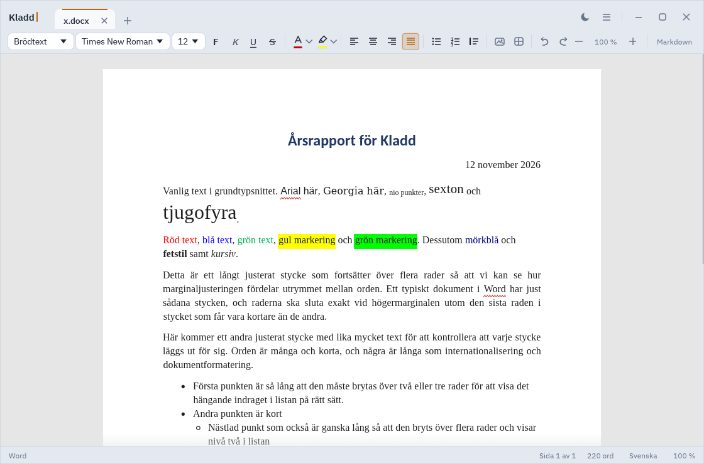

# Kladd – handbok

Den fullständiga beskrivningen av Kladds funktioner. En kort översikt finns i [README](../README.md).

## Funktioner

- **Flikar** – öppna flera filer samtidigt. `Ctrl+T` skapar en ny flik.
- **Säkerhetskopia och återställning** – osparade flikar sparas undan var 30:e sekund; efter en krasch erbjuder Kladd att återställa dem vid nästa start. Kan stängas av i *Inställningar → Allmänt*.
- **Spara automatiskt** – slå på i *Inställningar → Allmänt*: ändrade filer sparas två sekunder efter att du slutat skriva och när fönstret tappar fokus. Rör aldrig namnlösa flikar, PDF:er eller filer där sparning skulle tappa innehåll, och skriver inte över en fil som ändrats på disk.
- **Versionshistorik** – varje sparning lagrar en version (gallras automatiskt). *Arkiv → Versionshistorik…* jämför med aktuell text och kan återställa en version eller öppna den i en ny flik.
- **Mallar** – *Ny från mall…* (`Ctrl+Shift+N`) visar ett galleri med brev, rapport, mötesprotokoll, dagordning, CV, faktura, uppsats, anteckningar, README och tomma sidor, på svenska eller engelska. `{{platshållare}}` som namn och datum fylls i i ett formulär. *Spara som mall…* gör det aktuella dokumentet till en egen mall (under *Mina mallar*, i datakatalogens `mallar/`), och en .docx eller .odt kan importeras som mall. De inbyggda ligger som filer i `assets/templates/`.
- **Vim-läge** – *Vim-läge* i huvudmenyn ger Vim-tangentbindningar i textläget (av som standard; inte i dokumentläget eller PDF). Lägena normal, infoga, markera (tecken, rad, block), ersätt och kommandorad (`:`), med antal, operatorer (`d c y > < gu gU ~`) och rörelser, textobjekt (`iw aw ip ap i" a" i( a( i[ i{ it` m.fl.), register (`"a`–`"z`, `"+` för urklipp), markeringar, `.`, ångra/gör om, sökning (`/ ? n N * #`) och makron (`q`/`@`). Kommandoraden har `:w :q :wq :x :q! :e fil`, `:s` och `:%s` med Rusts reguljära uttryck, `:<rad>`, `:set nu/nonu/wrap/nowrap`, `:noh` och `:sp`/`:vs` (delad vy). Blockmarkör i normalläget, läget och väntande kommando visas i statusraden. Kladds Ctrl-genvägar fungerar som vanligt utom de Vim använder i normalläget (`Ctrl+d`, `u`, `r`, `v`, `o`). Flera markörer är avstängda medan Vim-läget är på.
- **Öppna och spara** `.txt`, `.md`, Word-dokument (`.docx`), OpenDocument-text (`.odt`), många kodformat och PDF. PDF:er visas i en PDF-visare, se [PDF](#pdf). E-böcker (`.epub`) öppnas i ett läsläge, se [EPUB](#epub). PowerPoint-presentationer visas med miniatyrer, bildspel och anteckningar, se [PowerPoint](#powerpoint).
- **Utskrift** med `Ctrl+P` till CUPS-skrivare (kopior, sidintervall, dubbelsidigt) eller som PDF. PDF-filen följer dokumentets sidstorlek och marginaler och har sidnummer i sidhuvud och sidfot.
- **Klistra in formaterad text** från Word, LibreOffice, Google Dokument och webbsidor. Ctrl+Shift+V klistrar in utan formatering.
- **Förlustfri Word-sparning** – Word-filer sparas med alla sina delar kvar, se [Word-dokument](#word-dokument).
- **Syntaxfärgning** och radnummer.
- **Språkservrar (LSP)** för kodfiler i textläget: felmarkeringar med krumelurer, ikon i marginalen och hovertext, panelen *Problem* (klicka för att hoppa dit), komplettering (efter `.`, `::` m.fl. eller `Ctrl+Space`; pilar, `Enter`/`Tab`), hover, gå till definition (`F12` eller `Ctrl+klick`), referenser (`Skift+F12`), byt namn (`F2`), formatera dokumentet (`Skift+Alt+F`) och signaturhjälp. Kladd startar rust-analyzer, pyright-langserver (eller pylsp), typescript-language-server, gopls och clangd när de finns på PATH, första gången en fil av språket öppnas, med projektets rot (arbetsmappen eller närmaste `Cargo.toml`, `pyproject.toml`, `package.json`, `go.mod`, `.git`). Statusraden visar serverns läge, t.ex. *rust-analyzer: indexerar…*. Egna kommandon och av/på ställs in under *Språkservrar…* i menyn.
- **Stora filer** – textfiler från 5 MB eller 200 000 rader (loggar, 100 MB-filer, kodfiler med en miljon rader) öppnas i en egen snabb vy som bara ritar de synliga raderna: filer över 20 MB läses in i bakgrunden med förlopp, radbrytning och färgning är avstängda, sökning går i bitar (högst 50 000 träffar visas) och ångra, radnummer, markering och sök fungerar som vanligt. Stora `.md`-filer öppnas ändå i läsläget (bara de synliga blocken ritas). Se `docs/dev/prestanda.md`.
- **Sök och ersätt** med `Ctrl+F` och `Ctrl+H`, med alternativ för versaler, hela ord och reguljära uttryck (`$1` och `${namn}` fungerar i ersättningen). I dokumentläget söker Kladd i den synliga texten, så "fet text" hittar `**fet** text`. Du kan också söka på formatering (fetstil, kursiv, färg, markering, rubrik) och låta *Ersätt* lägga på eller ta bort formatering på träffarna.
- **Tabellvy för csv och tsv** – `.csv`, `.tsv` (och annan avgränsad text, via *Tabell | Text* i statusraden) visas som ett rutnät med rubrikrad och radnummer som ligger kvar vid rullning, och klarar hundratusentals rader. Kladd gissar avgränsare (`,` `;` tabb `|`), citattecken och om första raden är rubrik; båda går att ändra i verktygsraden. Dubbelklicka, `F2` eller skriv för att redigera en cell (Enter, Tab och piltangenter flyttar), markera med Skift/Ctrl, kopiera och klistra in rektanglar som TSV (Excel och LibreOffice), infoga och ta bort rader och kolumner i högerklicksmenyn, sortera på en kolumn (tal, naturlig ordning eller text med svensk ordning), filtrera rader och sök med `Ctrl+F` (träffarna markeras i cellerna). Statusraden visar antal, summa, medel, min och max för markeringen, även för `1 234,5`. Allt är ändringar i dokumentets text (`Ctrl+Z` och `Ctrl+Y` ångrar), och orörda rader, avgränsare, citat, radslut och avslutande radbrytning bevaras byte för byte.
- **Läsläge för Markdown** – en öppnad `.md`-fil visas färdig i hela fönstret, med ekvationer (se *Ekvationer* nedan). *Redigera* uppe till höger (eller `Ctrl+Shift+M`) byter till texten, och sidknappen i namnlisten eller `Ctrl+Shift+M` går tillbaka. `Ctrl+F` söker i den visade texten (träffarna markeras, `F3`/`Skift+F3` hoppar), rubrikerna i navigeringsfönstret (`Ctrl+Skift+O`) rullar vyn, kryssrutor (`- [ ]`) bockas av med ett klick (`Ctrl+Z` ångrar) och dubbelklick på ett stycke öppnar redigeraren där du klickade. Ersätt (`Ctrl+H`) och Gå till rad byter till redigeraren. Länkar har länkfärg och tabeller har linjer, fet rubrikrad och radbrytning. Vill du hellre ha förhandsvisningen bredvid texten när du redigerar slår du på *Visa → Förhandsvisning bredvid texten*.
- **Delad vy** – `Ctrl+\` delar fönstret i två rutor bredvid varandra, `Ctrl+Shift+\` över varandra (eller *Dela vyn* / *Dela vågrätt* i menyn). Välj flik per ruta i rutans egen väljare, eller visa samma dokument två gånger med egen rullning. Dra skiljelinjen för att ändra storleken; `F6` byter aktiv ruta.
- **Arbetsmapp** (`Ctrl+Shift+E`): filträd i en sidopanel med nytt, byt namn och ta bort (till papperskorgen), **snabböppna** (`Ctrl+E`) med suddig filnamnssökning och **sök i filer** (`Ctrl+Shift+F`) i mappen eller alla flikar, med ersättning över flera filer.
- **Git** – är arbetsmappen ett git-arkiv (och finns `git` på datorn) visar filträdet status per fil (`M` ändrad, `A` ny och köad, `U` ospårad, `D` borttagen, `!` konflikt; mappar med ändringar får en punkt) och statusraden grenen med `↑`/`↓` för skillnad mot fjärrgrenen. I textläget visar marginalen tillagda (grön), ändrade (blå) och borttagna rader (röd triangel) mot HEAD; ett klick på en markör visar de gamla raderna med *Återställ ändringen*. *Arkiv → Jämför med HEAD…* visar en diff, *Visa blame* skriver författare, ålder och incheckningsmeddelande per rad i marginalen. **Källkontroll** (`Ctrl+Shift+G`, eller *Källkontroll* i panelen) listar köade och ändrade filer med köa, ta ur kön, förkasta (med bekräftelse) och jämför, en ruta för incheckningsmeddelande med *Checka in* (`Ctrl+Enter`) och *Checka in och pusha*, hämta, pulla och pusha, byte och skapande av gren samt de 50 senaste incheckningarna. Fel från git visas som notiser med git:s eget meddelande. Allt körs med programmet `git` i bakgrunden; saknas det döljs alla Git-funktioner.
- **Navigeringsfönster** med rubrikerna som ett träd (`Ctrl+Shift+O`) och **innehållsförteckning** med sidnummer i dokument, se [Navigering och innehållsförteckning](#navigering-och-innehållsförteckning).
- **Två teman** – *Gryning* och *Skymning*.
- **Svenska och engelska** – välj *Språk / Language* i *Inställningar → Allmänt*; Automatiskt följer systemets språk. Hela gränssnittet finns på båda språken.
- **Teckenkodning** – UTF-8, UTF-16 och Windows-1252, med bevarade radslut.
- **Dra och släpp** filer direkt i fönstret.
- **Ett fönster** – filer som öppnas från filhanteraren eller terminalen läggs som nya flikar i det Kladd-fönster som redan är öppet. Använd `kladd --new-window` för ett separat fönster.
- **Dokumentläge** – Word- och OpenDocument-dokument visas som ett dokument med riktiga sidor, formateringsfält och sidnummer. Se [Word-dokument](#word-dokument).
- **Stavningskontroll** i dokumentläget, med svenska och engelska ordlistor från systemet, eller hämtade i Kladd på Windows och macOS.
- **Uppdateringar** – Kladd kollar högst en gång per dygn på GitHub om det finns en nyare version och visar då ett diskret fält med *Visa nyheter*, *Hämta och installera*, *Senare* och *Hoppa över*. Installationsfilen hämtas för ditt system (Windows-installationsprogram, macOS-skivavbild, .deb eller AppImage) och inget körs förrän du klickar. Kontrollen kan stängas av i *Inställningar → Allmänt*, och *Hjälp → Sök efter uppdateringar* kontrollerar direkt.

- **Menyrad, kommandopalett och inställningar** – menyraden *Arkiv · Redigera · Visa · Infoga · Verktyg · Hjälp* (och *Format* i dokumentläget) ligger i övre raden; i ett smalt fönster samlas menyerna under hamburgerknappen som undermenyer. Menyerna visar bara det som hör till läget (text, dokument eller PDF). `Ctrl+Shift+P` öppnar kommandopaletten: skriv några bokstäver av ett kommando (på svenska eller engelska) så visas det med kategori och kortkommando, senast använda överst; Enter kör det. `Ctrl+,` öppnar *Inställningar* med sektionerna Allmänt (språk, tema, textstorlek, uppdateringar, spara automatiskt, säkerhetskopior), Redigerare, Dokument (författarnamn, stavning, grammatik och server), PDF och Avancerat.

## Kom igång

Ladda ner det senaste paketet för ditt system från [Releases](https://github.com/felixarvid2/kladd-text-editor/releases/latest).

**Linux (Ubuntu/Debian)** – installera `.deb`-paketet:

```bash
sudo apt install ./kladd_*.deb
```

**Linux (alla distributioner)** – hämta `Kladd-<version>-x86_64.AppImage`, gör den körbar och starta den:

```bash
chmod +x Kladd-*-x86_64.AppImage
./Kladd-*-x86_64.AppImage
```

(Saknar systemet FUSE kan du köra `./Kladd-*-x86_64.AppImage --appimage-extract-and-run`.)

**Windows** – kör `Kladd-<version>-windows-x64-setup.exe`. Installationen sker för din användare och kräver inte administratör (dialogen låter dig välja installation för alla). Du kan lägga till en genväg på skrivbordet och låta Kladd synas under *Öppna med* för `.docx`, `.odt`, `.md` och `.txt`. Vill du slippa installera finns även `Kladd-<version>-windows-x64.zip`: packa upp och kör `kladd.exe`. Programmet är inte signerat, så Windows SmartScreen varnar vid första starten: välj *Mer information* och sedan *Kör ändå*.

**macOS** (11 eller nyare, Apple Silicon och Intel) – öppna `Kladd-<version>-macos-universal.dmg` och dra Kladd till mappen Program. Programmet är inte notariserat, så första gången måste du högerklicka på Kladd och välja *Öppna* (och bekräfta). Alternativt tar du bort karantänmärkningen i Terminalen:

```bash
xattr -dr com.apple.quarantine /Applications/Kladd.app
```

På macOS öppnas filer från Finder i Kladd: *Öppna med*, dubbelklick (efter *Hämta info* → *Öppna med* → *Ändra alla…*) och att dra filer till ikonen i Dock. De läggs som nya flikar i det öppna fönstret. Kladd är bara ett alternativ i *Öppna med* och tar inte över någon filtyp av sig själv.

**Signering:** just nu är varken Windows- eller macOS-paketen signerade (därav varningarna ovan) och AppImagen är osignerad. Release-workflowen kan signera och notarisera så fort certifikat finns, se [docs/dev/signering.md](dev/signering.md).

Nyheter i varje version står i [CHANGELOG.md](../CHANGELOG.md).

Du kan också bygga Kladd från källkoden:

```bash
cargo build --release
./target/release/kladd
```

<details>
<summary>Bygg ett .deb-paket</summary>

```bash
cargo install cargo-deb --locked   # en gång
cargo deb                          # skapar paketet i target/debian/
```

Avinstallera med `sudo apt remove kladd`.

En ny release skapas automatiskt när en versionstagg pushas. Höj först `version` i `Cargo.toml`, och tagga sedan samma version:

```bash
git tag v1.4.0
git push origin v1.4.0
```

Det går också att köra workflowen *Release* för hand under Actions och kryssa i *Publicera release*. Då skapas taggen från versionen i `Cargo.toml`.

Release-anteckningarna hämtas från avsnittet för versionen i `CHANGELOG.md`; finns inget avsnitt skapas anteckningarna automatiskt. Skriv anteckningarna i `CHANGELOG.md` innan du taggar. För en redan publicerad release: kör workflowen för hand, fyll i *update_notes* med taggen (till exempel `v1.5.0`) och lämna *Publicera release* ikryssad av. Då byts bara anteckningarna ut.

</details>

## Word-dokument

Kladd öppnar `.docx` och `.odt` (LibreOffice) i dokumentläge, som liknar ett Word-dokument. När du sparar som `.docx` blir det ett riktigt Word-dokument som öppnas i Word, LibreOffice och Google Dokument. `.odt` sparas som OpenDocument-text. Med *Spara som* kan vilken flik som helst sparas som `.docx`.

### Dokumentläge



Ett öppnat `.docx` visas på vita sidor mot grå bakgrund, med sidstorlek och marginaler från dokumentet och typografi som liknar Word. Dokumentets typsnitt, storlekar, färger, markeringar och styckejustering (vänster, centrerat, höger och marginaljustering) visas som i Word. Typsnitten hämtas från systemet precis som i LibreOffice, så Arial visas med Liberation Sans och Times New Roman med Liberation Serif. Calibri visas med Carlito och Cambria med Caladea, som har samma mått (båda följer med i Kladd, så de ser likadana ut på alla system; ett installerat Calibri eller Cambria på Windows och macOS används i stället). Calibri Light har ingen fri motsvarighet och visas i Carlito. Georgia visas med Gelasio om det finns installerat. Styckeramar och skuggade rutor (även ihopslagna över flera stycken), exakt avstånd mellan stycken, indrag och tomma stycken visas som i Word. Listor dras in med hängande indrag, tabeller ritas som rutnät med celler som bryter långa rader, `Enter` för radbrytning i cellen, sammanfogade celler och kolumnbredder som du ändrar genom att dra i kanten, och bilder visas i texten. Markdown-koden är dold; den visas nedtonad bara på raden där markören står. Fotnoter visas som små upphöjda siffror, med texten under en kort skiljelinje längst ned på sidan där referensen står (sidan får plats reserverad, och en rad vars fotnot inte ryms flyttas till nästa sida): *Infoga fotnot* i verktygsraden (`Ctrl+Alt+F`) lägger till en och numrerar om, klicka på fotnoten eller dubbelklicka referensen för att redigera den på sidan (Enter eller Esc avslutar), och fotnoterna följer med som riktiga fotnoter när du sparar som `.docx` eller `.odt` och hamnar längst ned på sidan i PDF. Slutnoter (`Ctrl+Alt+D`, *Infoga → Slutnot*) visas med romerska tal efter dokumentets sista text och följer med som riktiga slutnoter i `.docx` och `.odt` och efter sista texten i PDF. Numren visas i dokumentets talformat (1, 2, 3, i, ii, iii, a, b, c, A, B, C eller *, †, ‡ med eget startnummer) från Words och LibreOffices inställningar, och *Infoga → Fotnoternas numrering* och *Slutnoternas numrering* i verktygsraden byter format, som sparas i filen. Spårade ändringar och kommentarer i `.docx` och `.odt` visas också: infogad text är understruken och raderad text struken i författarens färg, kommentarerna ligger i ett fält till höger om sidan, och menyn *Granska* (spåra ändringar `Ctrl+Skift+E`, godkänn och avvisa, nästa och föregående ändring, ny kommentar `Ctrl+Alt+M`, svara, ta bort, visa/dölj och *Ditt namn…*) redigerar dem. De sparas som riktiga Word-ändringar och kommentarer, och i `.odt` som LibreOffice-ändringar och kommentarer; PDF och HTML får den godkända texten.

Ett öppnat `.docx` visas på vita sidor mot grå bakgrund, med sidstorlek och marginaler från dokumentet och typografi som liknar Word. Dokumentets typsnitt, storlekar, färger, markeringar och styckejustering (vänster, centrerat, höger och marginaljustering) visas som i Word. Typsnitten hämtas från systemet precis som i LibreOffice, så Arial visas med Liberation Sans och Times New Roman med Liberation Serif. Calibri visas med Carlito och Cambria med Caladea, som har samma mått (båda följer med i Kladd; ett installerat Calibri eller Cambria på Windows och macOS används i stället). Calibri Light har ingen fri motsvarighet och visas i Carlito. Georgia visas med Gelasio om det finns installerat. Listor dras in med hängande indrag, tabeller ritas som rutnät med celler som bryter långa rader, `Enter` för radbrytning i cellen, sammanfogade celler och kolumnbredder som du ändrar genom att dra i kanten, och bilder visas i texten. Markdown-koden är dold; den visas nedtonad bara på raden där markören står. Fotnoter visas som små upphöjda siffror, med texten under en kort skiljelinje längst ned på sidan där referensen står (sidan får plats reserverad, och en rad vars fotnot inte ryms flyttas till nästa sida): *Infoga fotnot* i verktygsraden (`Ctrl+Alt+F`) lägger till en och numrerar om, klicka på fotnoten eller dubbelklicka referensen för att redigera den på sidan (Enter eller Esc avslutar), och fotnoterna följer med som riktiga fotnoter när du sparar som `.docx` eller `.odt` och hamnar längst ned på sidan i PDF. Slutnoter (`Ctrl+Alt+D`, *Infoga → Slutnot*) visas med romerska tal efter dokumentets sista text och följer med som riktiga slutnoter i `.docx` och `.odt` och efter sista texten i PDF. Numren visas i dokumentets talformat (1, 2, 3, i, ii, iii, a, b, c, A, B, C eller *, †, ‡ med eget startnummer) från Words och LibreOffices inställningar, och *Infoga → Fotnoternas numrering* och *Slutnoternas numrering* i verktygsraden byter format, som sparas i filen. Spårade ändringar och kommentarer i `.docx` visas också: infogad text är understruken och raderad text struken i författarens färg (infogade och raderade stycketecken ritas som ¶ respektive genomstruket ¶, och formateringsändringar får ett streck i marginalen och en prickad understrykning med verktygstipset *Formaterat: Fet*; med spårning på spåras även Enter, hopslagning av stycken och all formatering), kommentarerna ligger i ett fält till höger om sidan, och menyn *Granska* (spåra ändringar `Ctrl+Skift+E`, godkänn och avvisa, nästa och föregående ändring, ny kommentar `Ctrl+Alt+M`, svara, ta bort, visa/dölj och *Ditt namn…*) redigerar dem. De sparas som riktiga Word-ändringar och kommentarer; i `.odt` godkänns ändringarna och kommentarerna utelämnas, och PDF och HTML får den godkända texten.

**Stora dokument** (hundratals sidor) öppnas utan att fönstret fryser: en `.docx` eller `.odt` över 100 kB läses in i en bakgrundstråd med en förloppsruta nere till vänster, och dokumentet läggs sedan ut stegvis. Första sidan syns direkt och resten fylls i under de följande bildrutorna; statusraden visar *Sida 1 (lägger ut dokumentet: X %)* och, när en tillräcklig del är utlagd, *Sida 1 av ca N (lägger ut dokumentet: X %)* tills allt är klart; sidor som ännu inte lagts ut visar *Läggs ut…*. Under tiden går det att läsa, rulla och markera med musen; trycker du en tangent eller hoppar långt fram (sök, rubrikträdet, `Ctrl+End`) läggs resten ut direkt först. En färdigutlagd sida ser exakt likadan ut som om dokumentet lagts ut på en gång, och små dokument påverkas inte. När du skriver läggs bara stycket du ändrar om, och resten av dokumentet (sidorna efter, fotnoterna längst ned) tas från förra gången så länge ändringen inte flyttar texten efter den. I ett dokument på 400 sidor går ett tecken på ett par tusendels sekunder, också i en fotnot (som du redigerar genom att klicka på den längst ned på sidan), och i ett på 2000 sidor på ungefär fem tusendels sekunder. Ett tecken som gör stycket en rad längre eller kortare flyttar allt efter och tar längre tid (som förut).

Formateringsfältet ovanför texten har stilval (Brödtext, Titel, Underrubrik, Rubrik 1–6, Citat), typsnitt och storlek, textfärg och markeringsfärg, vänster-, center-, höger- och marginaljustering, knapparna F, K, U och S för fet, kursiv, understruken och genomstruken, punktlista, numrerad lista, citat, menyn *Infoga* (bild, tabell, fotnot, innehållsförteckning, avsnittsbrytning, liggande sidor och spalter), ångra och gör om, sidinställningar samt zoom. Statusfältet visar "Sida x av y", antal ord, språk för stavningskontrollen och zoomnivå.

### Äldre format: .doc, .rtf, .wpd och .wps

Kladd öppnar de här filerna genom att låta LibreOffice konvertera dem till `.docx` i bakgrunden (`soffice --headless --convert-to docx`, med en egen tillfällig profil så att det inte krockar med en LibreOffice som redan är öppen). I nedre vänstra hörnet står *Konverterar …* medan det pågår, och efter två minuter avbryts konverteringen. Resultatet öppnas i dokumentläget med en notis.

Fliken har originalets namn men skriver aldrig över originalet: *Spara* öppnar *Spara som* med `.docx` bredvid originalet som förslag, och automatisk sparning är avstängd för fliken. Kladd letar efter `soffice` eller `libreoffice` i `PATH`, och på Windows och macOS på LibreOffices vanliga installationsplats. Hittas inte LibreOffice visas ett fel som säger att det behövs (libreoffice.org). `.rtf`-filer öppnas då ändå med en enkel inbyggd läsare som tar med text, fet, kursiv och stycken.

### Förlustfri sparning

Kladd behåller alla delar av originalfilen, som sidhuvud, sidfot, fotnoter, kommentarer, teman och inställningar. Vid sparning skrivs bara de stycken om som du har ändrat; oförändrade stycken sparas exakt som de var. Objekt som Kladd inte kan visa, till exempel fotnotsreferenser, fält och textrutor, blir osynliga markörer `<!--k:N-->` i Markdown-texten och skrivs tillbaka när du sparar. Spårade ändringar och kommentarer blir `<ins>`, `<del>`, `<fmt>`, stycketeckensmarkörer och kommentarsmarkörer som följer med när du ändrar stycket.

### Navigering och innehållsförteckning

Navigeringsfönstret (`Ctrl+Shift+O`, knappen längst upp till höger eller *Navigeringsfönster* i menyn) visar rubrikerna i Word-, ODT-, PDF- och Markdown-flikar, i både dokumentläge och textläge. Klicka på en rubrik för att flytta markören dit; pilen fäller ihop underrubriker och fältet *Sök i rubriker* filtrerar listan.

*Infoga → Innehållsförteckning…* (i formateringsfältet eller menyraden) öppnar en dialog där du väljer vad förteckningen listar (rubriker, figurer eller tabeller) och vilka rubriknivåer som tas med (standard 1–3). *Infoga* sätter in raden `<!-- kladd: toc -->` vid markören (`<!-- kladd: toc; levels: 2-4 -->` med andra nivåer, `<!-- kladd: toc; kind: figures -->` för en figurförteckning och `kind: tables` för tabeller; raden går att skriva eller ändra för hand). I dokumentläget visas posterna med punktlinjer och sidnummer, indragna per nivå; klicka på en post för att hoppa dit. Förteckningen följer rubrikerna medan du skriver och sidnumren flyttar sig när sidbrytningarna ändras. Står markören på raden visas själva kommentaren. En figur- eller tabellförteckning hämtar sina poster ur stycken som börjar med bildtexten *Figur 1*, *Figure 1*, *Bild 1* respektive *Tabell 1*, *Table 1*.

Sparas dokumentet som `.docx` blir det ett riktigt innehållsförteckningsfält (`TOC \o "1-3" \h \z \u`, formatmallarna Innehåll 1–9; för figurer `TOC \c "Figur"`) med sidnummer ur Kladds egen sidbrytning, samma som i PDF. Word visar de sparade numren utan att fråga; vill du att Word räknar om dem (Words sidbrytning kan skilja sig något) högerklickar du på förteckningen och väljer *Uppdatera fält* eller trycker `F9`. Som `.odt` blir det en `text:table-of-content` (eller figur- och tabellindex) som LibreOffice uppdaterar via *Verktyg → Uppdatera*; i PDF får förteckningen punktlinjer, riktiga sidnummer och länkar och i HTML/EPUB en lista med länkar. Förteckningar som redan finns i ett öppnat Word- eller OpenDocument-dokument visas som samma rad, med nivåerna ur fältet (`\o "2-4"`), och behåller sitt utseende tills rubrikerna ändras. Då skrivs förteckningen om. Figurlistor i ODT byggs av LibreOffice upp ur bildtexter med löpnummer och blir tomma vid *Uppdatera* om bilderna inte har sådana.

### Sidor och utskrift

Knappen *Sidinställningar* (eller dubbelklick på sidhuvud eller sidfot) öppnar en dialog för sidstorlek (A4, A5, A3, Letter, Legal), stående eller liggande, marginaler, sidhuvud och sidfot. I sidhuvud och sidfot betyder `{sida}` och `{sidor}` sidnummer och antal sidor, `{datum}` dagens datum (ÅÅÅÅ-MM-DD), `{titel}` filnamnet utan ändelse och `{fil}` hela filnamnet. Med `|` delas texten i vänster, mitten och höger (`header: "Rapport|{titel}|{sida}"`), och `header-first`/`footer-first` ger första sidan eget sidhuvud och sidfot (`""` = tom). Dubbelklick på sidhuvudet eller sidfoten på en sida öppnar *Sidhuvud och sidfot* med tre fält per rad, knapparna *Infoga sidnummer*, *Antal sidor*, *Datum*, *Titel*, *Filnamn* och *Logga…* (välj en bildfil; loggan visas som miniatyr med namn och går att göra bredare eller smalare, *Ta bort logga* tar bort den), *Lägg till rad* för ett sidhuvud med flera stycken, valet *Sidnummerformat* (1, i, I, a, A) och rutan *Annorlunda första sida*. Flera rader i ett sidhuvud skrivs med `\n` (`header: "Skolan\nRapport 2025"`), och `header-style: "9pt #666666 bold italic underline"` ger textens storlek, färg, fet, kursiv och understruken stil. Delar av texten kan ha egen formatering som i brödtexten, per körning som i Word: `header: "**Skolrapport** · Klass 9B||Sida **{sida}** av {sidor}"` (`**fet**`, `*kursiv*`, `<u>understruken</u>`, `<span style="color: #C00000; font-size: 14pt">…</span>`); `header-style` är standardstilen och körningarna lägger bara till det som avviker. I dialogen markerar du texten i ett fält och trycker på **F**, **K** eller **U** (eller `Ctrl+B`, `Ctrl+I`, `Ctrl+U`); förhandsvisningen visar resultatet. Ett märke utan par är vanlig text, och `\*` skriver en riktig stjärna. Fälten följer med till PDF, utskrift, `.docx` (PAGE, NUMPAGES, DATE, TITLE, FILENAME) och `.odt`, och läses från Word- och LibreOffice-dokument med vänster/mitten/höger-layout (tabbstopp eller en tabell utan ramar). Loggor i sidhuvud och sidfot (`{bild:logo.png 80x30}`) visas och sparas, sidnummer kan ha format (`{sida:roman}`) och börja om per avsnitt (`page-start`), `{avsnittssidor}` är antalet sidor i avsnittet, och annorlunda första sida, olika udda/jämna sidor (`header-even`) och egna sidhuvuden per avsnitt (på avsnittsraden, med arv från föregående avsnitt) följer med som i Word. Inställningarna sparas i grundformatskommentaren:

```
<!-- kladd: page-size: A4; page-margin: 25mm; footer: "Sida {sida} av {sidor}"; footer-align: center -->
```

### Formatmallar

*Ändra formatmall…* bredvid stilvalet (eller högerklick på stilvalet) öppnar en dialog där du ändrar utseendet på Brödtext, Titel, Underrubrik, Rubrik 1–6 och Citat: typsnitt, storlek, fet, kursiv, färg, justering, luft före och efter, radavstånd och indrag av första raden. Dialogen har en förhandsvisning, och ändringarna gäller hela dokumentet direkt. *Uppdatera från markering* tar utseendet på texten vid markören och *Återställ* tar bort ändringarna i den valda formatmallen. De sparas i grundformatskommentaren, en rad per formatmall, och dokument utan sådana rader ser ut som förut:

```
<!-- kladd: h1: "Calibri Light" 16pt bold #2F5496 space-before 12pt space-after 6pt; body: justify line-spacing 1.15 -->
```

Word-dokumentets Normal, Title, Subtitle, Rubrik 1–6 och Citat läses in (med docDefaults, temafärger och typsnitt, teckenavstånd, versaler och linjen under stycket), och när du ändrar en formatmall skrivs ändringen tillbaka till formatmallen i `.docx`-filen (oförändrade dokument sparas som förut). `.odt` fungerar likadant, och PDF, HTML och EPUB följer formatmallarna (PDF har alltid sina inbäddade typsnitt).

### Avsnitt: liggande sidor och spalter

Som i Word kan en del av dokumentet ha egna sidor eller flera spalter. Öppna *Infoga* i formateringsfältet:

- **Avsnittsbrytning (ny sida)** börjar ett nytt avsnitt på en ny sida. Avsnittet börjar som det förra.
- **Sidbrytning** börjar en ny sida utan att ändra sidformat. Sidbrytningar i Word- och LibreOffice-dokument visas på samma sätt.
- **Liggande sidor härifrån** (och *Stående sidor härifrån*) vänder sidorna från markören och framåt. Står markören först i dokumentet gäller det hela första avsnittet.
- **Spalter…** ger avsnittet som markören står i 1, 2 eller 3 spalter med valfritt mellanrum. Texten flyter uppifrån och ned i första spalten, sedan i nästa och sedan på nästa sida.
- **Spaltbrytning** flyttar texten efter markören till nästa spalt.

Avsnittet börjar vid en egen rad som visas bara när markören står på den. Egenskaper som saknas ärver dokumentets grundformat (inte föregående avsnitt):

```
<!-- kladd: avsnitt; page: A4 landscape; page-margin: 20mm; columns: 2; column-gap: 12mm -->
```

`column-widths: 40mm 120mm` ger olika breda spalter och `column-rule: yes` en skiljelinje mellan spalterna (båda följer med till `.docx`, `.odt` och PDF, och läses från Word och LibreOffice). Ett stycke som fortsätter från en bredare spalt in i en smalare bryts i respektive spalts bredd. *Spalter…* nollställer bredderna och linjen när du byter antal spalter. `column-balance: no` på avsnittsraden stänger av utjämningen av avsnittets sista sida (`.odt`: `text:dont-balance-text-columns`).

Med `type: continuous` börjar avsnittet på samma sida (för att byta antal spalter mitt på en sida; spalterna i avsnittet före jämnas ut, också när de har olika bredd, och likadant i PDF; en manuell spaltbrytning på sidan stänger av utjämningen). Bilder och tabeller anpassas till spaltens bredd, sidnumren löper över avsnitten (om inte ett avsnitt börjar om med `page-start`) och sidhuvud och sidfot ärvs från föregående avsnitt tills ett avsnitt har egna. Avsnitten följer med till `.docx` (`w:sectPr`: sidstorlek, orientering, marginaler, spalter och typ), `.odt` (sidmallar, och `text:section` för spalter) och PDF.

### Ekvationer

Matematik skrivs med LaTeX-syntax: `$x^2$` mitt i en mening och `$$\int_0^1 f(x)\,dx$$` på en egen rad. I dokumentläget och Markdown-förhandsvisningen ritas formlerna som satt matematik (STIX Two Math; egen utläggning efter TeX:s regler), i dokumentläget i textflödet med källan dold utom på raden där markören står. *Infoga → Ekvation* lägger in `$$ $$` med markören inuti, och posterna under (bråk, kvadratrot, upphöjt, nedsänkt, summa, integral, gräns, parenteser, matris, grekiska) sätter in färdiga strukturer, i formeln om markören står i en. Stöd: upphöjt/nedsänkt och primtecken, `\frac` `\dfrac` `\binom`, `\sqrt[n]{}`, `\sum` `\int` `\prod` `\lim` med gränser (`\limits`), `\left`…`\right` och `\big`, grekiska och vanliga symboler och operatorer, `\text`, `\mathrm` `\mathbf` `\mathit` `\mathbb` `\mathcal` `\mathfrak`, `pmatrix`/`bmatrix`/`vmatrix`/`cases`/`aligned`/`array`, accenter (`\hat` `\bar` `\vec` `\dot` `\widehat` …), `\overline` `\underbrace` `\overset` och mellanrum (`\,` `\quad`). En formel som inte går att tolka visas som vanlig text. Tecknen `$` i vanlig text (`5 $ och 6 $`) och i kod räknas inte som matematik.

I `.docx` sparas formlerna som Office Math (`m:oMath`) och formler i Word-dokument läses som LaTeX; formler Kladd inte kan uttrycka bevaras som de var. `.odt` får ett formelobjekt (MathML) med ersättningsbild, PDF ritar formlerna som konturer och HTML och EPUB får MathML.

### Kodblock

Ett inhägnat kodblock (```` ```rust ````…```` ``` ````) ritas i dokumentläget som en ruta med svag bakgrund och typsnitt med fast breddsteg, och koden färgas efter språket i inhägnaden: rust, python, js/ts, json, toml, yaml, bash, c/c++, java, go, sql, html, css, xml, markdown med flera (okänt språk eller inget språk ger ofärgad kod). Färgerna passar det vita arket (det ljusa temats), och i mörkt tema utan vita sidor används det mörka. Inhägnadens rader är dolda tills markören står på dem. Språknamnet står diskret i rutans övre högra hörn, och när musen är över rutan visas en **kopieringsknapp** som kopierar koden (utan inhägnaden) till urklipp och visar *Koden kopierades*. Färgningen ändrar aldrig texten, och den läses in i bakgrunden vid start så att dokumentet syns direkt (koden är ofärgad någon bråkdel av en sekund).

Kodblocken följer med till exporterna: PDF ritar dem med bakgrund och samma färger, `.docx` skriver kodformatet med färgade körningar (språket sparas i ett dolt bokmärke och läses tillbaka), `.odt` skriver stycken med `text:span`-färger, och HTML/EPUB får `<pre><code class="language-x">` med färgade `<span>` (ser färgat ut utan extern CSS). I läsläget för Markdown finns kopieringsknappen sedan förut, och språknamnet visas nu i blockets hörn.

**Mermaid**: ett block med språket `mermaid` ritas som diagram (flödesscheman, sekvens-, tillstånds-, klass-, ER- och cirkeldiagram med flera) i läsläget, i dokumentläget och som vektorbild i PDF. I dokumentläget visas koden när markören står i blocket (klicka på diagrammet för att redigera det). Ett block som inte går att rita visas som kod. Sparas dokumentet som `.docx`, `.odt`, HTML eller EPUB skrivs diagrammet som en SVG-bild (i Word 2016 och senare, LibreOffice och webbläsare ritas det som diagram; äldre Word visar PNG-reserven) och Mermaid-koden följer med i bildens alternativtext, så att Kladd läser tillbaka blocket som ett `mermaid`-block när filen öppnas igen. Ändrar du koden i Kladd och sparar ritas diagrammet om; ändrar du bilden i Word blir den en vanlig bild vid nästa spar. Ett block som inte går att rita sparas som kodblock.

### Tabeller, bilder och inklistring

Tabeller redigeras direkt i rutnätet. Tab och Shift+Tab flyttar mellan cellerna, och Tab i sista cellen lägger till en rad. Skuggning, ramar, bredd, justering, cellmarginaler och radhöjd från Word och LibreOffice visas som i originalet (tabeller utan ramar visas utan linjer) och följer med när du sparar; *Skugga celler* och *Ramar runt alla celler* / *Inga ramar* finns i högerklicksmenyn. När markören står i en tabell visar formateringsfältet knappar för att lägga till och ta bort rader och kolumner eller hela tabellen. Samma funktioner finns i högerklicksmenyn.

Klicka på en bild för att markera den. Dra i hörnen för att ändra storlek (håll Skift för fri proportion) eller dra i själva bilden för att flytta den: en linje visar var den hamnar, och Esc avbryter. En liten verktygsrad vid bilden justerar läget (vänster, centrerat eller höger), väljer radbrytning (*I texten*, eller *Vänster*/*Höger* så att texten flyter runt bilden), återställer originalstorleken eller tar bort bilden. Delete tar bort en markerad bild. Flytande bilder sparas som förankrade bilder med textomflöde i Word och LibreOffice. Bilder från Word och LibreOffice behåller sitt läge (mot sidan, marginalen, spalten eller stycket), omflöde (runt, över och under, bakom eller framför texten), avstånd och beskärning; drar du en sådan bild sparas det nya läget.

Ctrl+V klistrar in formaterad text med rubriker, fetstil, kursiv, understrykning, färger, typsnitt, storlekar, justering, listor, tabeller, länkar och inbäddade bilder. Ctrl+Shift+V klistrar in oformaterad text.

Vill du se dokumentet som vanlig Markdown-text klickar du på *Markdown* i formateringsfältet. Klicka på *Visa som dokument* i statusfältet för att gå tillbaka.

### Stavningskontroll

I dokumentläget markeras felstavade ord med ett rött vågigt understreck medan du skriver. Högerklicka på ett ord för att se förslag, välja *Ignorera alla* eller *Lägg till i ordlistan*. Tillagda ord sparas i `~/.config/kladd/ordlista.txt` (på Windows och macOS i `ordlista.txt` i Kladds mapp, se nedan).

Kladd använder Hunspell-ordlistor (`.aff` och `.dic`). Språk och på/av väljer du genom att klicka på språket i statusfältet. Standardspråket är svenska när det är installerat, annars systemets språk (`$LANG` eller operativsystemets inställning).

- **Linux:** ordlistorna i `/usr/share/hunspell`, samma som LibreOffice använder på Ubuntu. Installera svenska med `sudo apt install hunspell-sv`; .deb-paketet föreslår `hunspell-sv` och `hunspell-en-us`.
- **Windows och macOS:** det finns inga ordlistor i systemet, så Kladd erbjuder att hämta dem. Finns ingen ordlista visar statusfältet *Ingen ordlista*; klicka där och välj *Hämta svensk ordlista* (eller *Hämta fler språk…* för engelska, norska, danska, tyska, franska och spanska). Kladd hämtar `.aff`- och `.dic`-filerna från [LibreOffices ordlistearkiv](https://github.com/LibreOffice/dictionaries) i bakgrunden och väljer språket när det är klart. Ordlistan har egen licens (LGPL/MPL …); licenstexten sparas bredvid den. Hämtningen följer `HTTPS_PROXY`. Ordlistorna hamnar i `~/Library/Application Support/Kladd/ordlistor` (macOS) respektive `%APPDATA%\Kladd\ordlistor` (Windows). Är LibreOffice installerat används dess ordlistor också, liksom `/Library/Spelling` och `~/Library/Spelling` på macOS.

Ordlistor i mappen som `$DICPATH` pekar på hittas på alla system.

### Autokorrigering

Kladd rättar texten medan du skriver, när du avslutar ett ord eller en mening med mellanslag, skiljetecken eller Enter. Det gäller i dokumentläget; i *Autokorrigering…* (huvudmenyn) kan du också slå på det för Markdown och vanlig text (aldrig kodfiler) och slå av varje regel för sig:

- typografiska citattecken efter språk: svenska ”…” och ’, engelska “…” och ‘…’
- `--` blir – och `---` blir —, `...` blir …, `(c)` blir ©, `(r)` blir ® och `(tm)` blir ™
- stor bokstav i början av meningar och stycken, men inte efter förkortningar (t.ex., bl.a., e.g.), i tal som 3.5, i webbadresser eller i ord som iPhone
- två inledande versaler rättas (SVerige blir Sverige)
- en liten inbyggd lista med vanliga svenska och engelska stavfel
- egna ersättningar, till exempel `mvh` till *Med vänliga hälsningar* (versal i början följer med: `Mvh`)

Språket följer stavningskontrollen (eller väljs i dialogen). Markdown-syntax, kodspann och kodstaket, länkar, HTML och kommentarer lämnas orörda. Ctrl+Z direkt efter en rättelse tar bara tillbaka rättelsen, som i Word. Autokorrigeringen är av medan ändringar spåras.

### Grammatik och stil

Grammatikkontrollen använder [LanguageTool](https://languagetool.org/http-api/) och är **av som standard**. Klicka på *Grammatik* i statusfältet (eller *Verktyg → Grammatikkontroll*, eller sektionen *Dokument* i *Inställningar*) för att slå på den och välja server: *LanguageTools server (api.languagetool.org)* eller en egen adress, till exempel `http://localhost:8081` för en lokalt installerad LanguageTool. Med den publika servern skickas texten du skriver över internet; det förklaras en gång innan funktionen slås på. Språket följer stavningsspråket (annars väljer servern automatiskt).

Bara synlig text skickas, utan Markdown-syntax, och bara stycken som ändrats, ungefär 1,5 sekunder efter att du slutat skriva. Kladd håller sig inom den publika serverns gränser (20 anrop per minut, 20 kB per anrop). Grammatikfel markeras med blått och stilråd med bärnstensgult vågigt understreck. Håll pekaren över ett understreck för förklaringen, eller högerklicka för upp till fem förslag, *Ignorera* och *Ignorera regeln* (gäller sessionen). Statusfältet visar antalet träffar. Stavning kontrolleras fortfarande av Hunspell.

| I Word | I Kladd |
|---|---|
| Rubriker och titel | `#` … `######` |
| Fetstil, kursiv, understruken, genomstruken | `**fet**`, `*kursiv*`, `<u>understruken</u>`, `~~struken~~` |
| Typsnitt, storlek, textfärg, markering | `<span style="font-family: Arial; font-size: 14pt; color: #C00000; background-color: #FFFF00">…</span>` |
| Centrerat, högerjusterat, marginaljusterat | `<div align="center">` … `</div>` |
| Dokumentets grundtypsnitt | `<!-- kladd: font-family: "Times New Roman"; font-size: 12pt -->` på första raden |
| Sidstorlek, marginaler, sidhuvud och sidfot | Samma kommentar: `page-size: A4; page-margin: 25mm; footer: "Sida {sida} av {sidor}"` |
| Formatmallar (Brödtext, Rubrik 1–6, Citat) | Samma kommentar: `h1: "Calibri Light" 16pt bold #2F5496 space-before 12pt; body: justify line-spacing 1.15; quote: italic` |
| Fotnoter, fält m.m. | `<!--k:N-->` (osynlig markör, skrivs tillbaka vid sparning) |
| Textruta | `<!--k:tb N w="…" h="…" x="…" y="…" wrap="…"-->` … `<!--k:/tb-->` före stycket (innehållet är vanliga stycken med `<!--k:pp …-->` för fyllning och ram; måtten och läget är samma attribut som för bilder) |
| Spårad infogning och radering | `<ins data-k="3">text</ins>`, `<del data-k="4">text</del>` (författare och datum i en postrad sist) |
| Spårat stycketecken | `<!--k:pm ins 5-->` / `<!--k:pm del 5-->` sist på raden, före radbrytningen |
| Spårad formatering | `<fmt data-k="6">text</fmt>` (teckenformat) och `<!--k:pm fmt 7-->` (styckeformat); det gamla formatet står i postradens `old` |
| Kommentar | `<!--k:c:1-->text<!--k:/c:1-->` och en postrad `<!--k:c id="1" …-->` sist |
| Liggande sidor, andra marginaler, spalter | `<!-- kladd: avsnitt; page: A4 landscape; columns: 2 -->` på en egen rad (börjar ett avsnitt), `<!-- kladd: spaltbrytning -->`; `<!-- kladd: sidbrytning -->` på en egen rad ger en ny sida |
| Punktlistor och numrerade listor | `-` och `1.` |
| Citat | `>` |
| Tabeller | `\| kolumn \| kolumn \|` |
| Länkar | `[text](https://…)` |
| Kod | `` `kod` `` och kodblock |
| Bilder (PNG, JPEG, GIF, BMP, WebP, SVG) | `` |
| Bildstorlek | `` |

Bilder i dokumentet följer med när du sparar och syns i förhandsvisningen. Lägg till egna bilder med *Infoga bild…* (`Ctrl+Shift+I`), genom att dra in en bildfil i fönstret eller genom att skriva ``. Sökvägen kan vara relativ till dokumentet. När dokumentet sparas som `.docx` bäddas bilderna in. WebP och SVG kan infogas på samma sätt. WebP sparas som PNG i `.docx`, `.odt` och PDF. En SVG behåller sin vektorkvalitet: i `.docx` skrivs den som Word 2016+ gör (SVG-filen i `word/media` med en PNG-reserv för äldre program), i `.odt` som LibreOffice (SVG-filen och en PNG-reserv efter), i PDF ritas den som vektor (text i SVG blir text) och i HTML och EPUB följer SVG-filen med. Öppnas ett sådant dokument i Kladd igen finns SVG:n kvar. I dokumentläget och vid utskrift ritas SVG:n som ett raster i dubbel upplösning, i sin egna storlek (`width`/`height`, annars `viewBox`); text i SVG ritas med systemets typsnitt och externa filer som SVG:n länkar till läses inte. Originalfilen ändras inte. En SVG-fil som du drar in öppnas som text om du inte har ett Markdown- eller Word-dokument aktivt. Sparar du ett Word-dokument som Markdown hamnar bilderna i en mapp bredvid filen.

Textrutor visas med rutans fyllning, ram, bredd, fasta höjd och läge, och texten flyter runt förankrade rutor som runt förankrade bilder (i dokumentläget och i PDF-exporten). Texten i rutan kan ändras, *Infoga → Textruta* lägger till en ny, och rutor i tabellceller, rubriker, listor och med bilder visas. Klicka på rutans kant för att markera den, dra i kanten för att flytta den och i handtagen för att ändra storlek; läget och storleken följer med till `.docx` och `.odt`. Finns inte plats för text på någon sida om rutan (den står mitt i en smal spalt) hoppar texten förbi rutan i stället för att ritas över den. En ruta får stå ut i marginalen (också över papperets kant, men den klämms så att den inte försvinner); texten flyter bara runt den del som ligger i spalten, och en ruta helt i marginalen påverkar inte texten. Klicka i brödtexten bredvid en ruta för att placera markören där, pil upp/ned hoppar över rutans rader, och i rutan rör de sig inom den. Diagram, former och sidhuvuden visas inte i texten, men de bevaras när filen sparas (se [Förlustfri sparning](#förlustfri-sparning)). Kladd frågar innan originalet skrivs över. Lösenordsskyddade filer stöds inte.

Läsning och skrivning bygger på samma teknik som [WordCraft](https://github.com/storytold/wordcraft) (MIT/Apache-2.0).

## PDF

En PDF öppnas i en PDF-visare som visar sidorna som de ser ut. Sidorna renderas med [hayro](https://github.com/LaurenzV/hayro) i bakgrundstrådar, så gränssnittet inte fryser, och de är skarpa på HiDPI-skärmar. Sidorna ligger på vita ark mot en grå bakgrund med kontinuerlig rullning. Zoomen har lägena Automatisk, Verklig storlek, Hel sida och Sidbredd, och går från 10 till 2500 %. Du kan visa en sida eller två sidor åt gången, rotera sidorna och välja färgläge (normala, inverterade eller sepia). Sida, zoom och rotation sparas per fil. PDF:er som visaren inte kan läsa öppnas som text, som förut.

| Kommando | Funktion |
|---|---|
| `F4` | Sidopanel med miniatyrer och innehållsförteckning |
| `Ctrl+F` | Sök i hela dokumentet |
| `Ctrl+G` | Gå till sida |
| `F5` | Presentationsläge (Esc avslutar) |
| `R` / `Shift+R` | Rotera |
| `H` | Handverktyg |
| `Ctrl++` / `Ctrl+-` / `Ctrl+0` | Zooma in / ut / 100 % |
| `Ctrl+1` / `Ctrl+2` / `Ctrl+3` | Verklig storlek / sidbredd / hel sida |
| `Alt+Vänster` / `Alt+Höger` | Bakåt / framåt i historiken efter länkar och hopp |

**Ordna sidor.** Klicka, Ctrl+klicka eller Skift+klicka på miniatyrerna för att markera sidor och dra dem för att flytta (en linje visar var de hamnar). Högerklicka för *Rotera åt höger/vänster*, *Ta bort* (eller Delete), *Extrahera till ny PDF…* och *Infoga PDF före/efter…*; *Slå ihop med PDF…* i Visa-menyn lägger till en fil sist. Ändringarna görs direkt i minnet och kan ångras med `Ctrl+Z` och göras om med `Ctrl+Shift+Z`. Fliken blir ändrad; `Ctrl+S` sparar över originalet (atomiskt) och *Spara kopia…* sparar under nytt namn. Typsnitt och bilder följer med sidorna, men bokmärken i en infogad fil tas inte med och en lösenordsskyddad PDF sparas utan lösenord. Mellanslag+dra panorerar som handverktyget.

**Känn igen text (OCR):** skannade sidor (sidor utan text som består av en bild) kan göras sökbara. Kladd använder kommandoradsprogrammet [Tesseract](https://github.com/tesseract-ocr/tesseract) om det finns installerat (`sudo apt install tesseract-ocr tesseract-ocr-swe`, `brew install tesseract tesseract-lang` eller installationsprogrammet från UB Mannheim på Windows). Välj *Visa → Känn igen text (OCR)* eller svara på meddelandet som visas när dokumentet har skannade sidor. Sidorna renderas i 300 dpi i bakgrunden, språken väljs bland de installerade (svenska och engelska, plus systemspråket) och förloppet visas i statusraden. Därefter fungerar sök, markering och kopiering som på andra sidor, och *Redigera* tar med den igenkända texten.

**Anteckna** i verktygsraden visar anteckningsverktygen: Markera (gul, grön, blå, rosa), Understruken, Genomstruken, Anteckning, Textruta och Penna. Markera text och släpp musknappen så läggs markeringen på; Anteckning och Textruta placeras med ett klick, Penna ritas med musen. Högerklick tar bort en ny anteckning och *Ångra* den senaste. Anteckningarna sparas med `Ctrl+S` som riktiga PDF-anteckningar (`/Annots` med utseende), så de syns i alla PDF-läsare; *Spara kopia* tar med dem i kopian. Fliken är ändrad och frågar om du vill spara tills det är gjort. En krypterad PDF sparas utan lösenordsskydd. Anteckningar som redan finns i filen går att ändra och ta bort: klicka på dem i Anteckna-läget för en ruta med författare, datum, kommentar, färg och *Ta bort* (Ångra och Ctrl+Z gäller även dessa), håll pekaren över en anteckning för att se vem som skrev den och vad, och fliken *Kommentarer* i sidopanelen listar alla anteckningar och hoppar dit.

**Formulär.** Har PDF:en ifyllbara fält (AcroForm) visas raden *Det här dokumentet har formulärfält* med knappen *Markera fält* (ljusblå markering). Klicka på ett fält för att fylla i det: text (en eller flera rader, lösenord, rutor för ett tecken per ruta), kryssrutor, alternativknappar, rullgardinslistor och listrutor. `Tab` och `Shift+Tab` går till nästa och föregående fält, `Esc` lämnar fältet och mellanslag växlar en kryssruta. Ifyllda värden gör fliken ändrad: `Ctrl+S` sparar dem i originalfilen (atomiskt, med nya utseenden för fälten), *Spara kopia* och utskrift tar med dem, och stängning frågar om du vill spara. Krypterade PDF:er kan inte fyllas i ännu.

**Redigera** gör om PDF:en till ett redigerbart dokument, som öppnas i dokumentläget. Kladd läser texten och visar den med rubriker, stycken, punkt- och numrerade listor, tabeller, fetstil, kursiv och bilder. Läsordningen följer spalterna, avstavning vid radslut tas bort, sidnummer i sidhuvud och sidfot hoppas över och stycken som fortsätter på nästa sida fogas ihop. Lösenordsskyddade PDF:er öppnas efter att du skrivit lösenordet. Originalet ändras inte förrän du sparar.

Spara som `.pdf` för att få en A4-PDF med inbäddade typsnitt (IBM Plex, eller Carlito och Caladea när dokumentet använder Calibri, Cambria eller ett annat serif-typsnitt), sökbar text, klickbara länkar, bokmärken från rubrikerna, bilder och sidnummer.

En PDF är byggd för utskrift, inte för redigering. När du sparar en PDF som har gjorts om med *Redigera* skapar Kladd därför en ny PDF av texten, och originalets sidlayout och typsnitt ersätts. Kladd frågar innan originalet skrivs över. Sidor som bara består av bilder (skannade sidor) har ingen text att läsa; Kladd säger till när det gäller.

Läsningen bygger på samma metoder som [PdfCraft](https://github.com/storytold/pdfcraft) och skrivningen på samma upplägg som [WordCraft](https://github.com/storytold/wordcraft) (båda MIT/Apache-2.0), med [lopdf](https://crates.io/crates/lopdf) och [krilla](https://crates.io/crates/krilla). Sidorna i PDF-visaren renderas med [hayro](https://github.com/LaurenzV/hayro) (MIT/Apache-2.0).

## EPUB

En `.epub` öppnas i ett läsläge för bara läsning, med ett gränssnitt som liknar andra e-boksläsare. Fliken heter bokens titel (filnamnet står som verktygstips) och boken öppnas där du slutade läsa; första gången står den vid början, där omslaget visas skalat så att det får plats i fönstret. Stora böcker läses in i bakgrunden med förlopp. Kopieringsskyddade böcker (DRM från Adobe eller Apple) går inte att öppna och ger felet *Boken är kopieringsskyddad (DRM) och kan inte öppnas*; typsnittsobfuskering räknas inte som skydd.

**Läsytan.** Texten står i en centrerad spalt (cirka 70 tecken) med serifftypsnitt och luftiga marginaler. Kapitlen ritas ett i taget; är ett kapitel mycket långt delas det vid styckegränser och *Fortsätt ›* längst ner går vidare. I slutet av ett kapitel står *Nästa kapitel: …*. Rubriker, stycken, fet och kursiv text, länkar, bilder (aldrig uppskalade; SVG-bilder och SVG-omslag visas), listor (också nästlade), citat, kodblock, tabeller, linjer, upphöjd och nedsänkt text och definitionslistor visas; förlagets typsnitt, färger och storlekar används inte (Kladds typografi gäller), men det förlaget säger om justering, indrag och små versaler följer med, se *Typografi (Aa)*. Längst upp står bokens och kapitlets titel (klicka för *Om boken*) och knapparna *Aa*, bokmärkesknappen och *Redigera en kopia*. Längst ner visar en tunn framstegslinje var du är, med streck vid kapitelgränserna (hovra för kapitlets namn, klicka för att hoppa dit, klicka mellan strecken för att hoppa i boken), *Kapitel 7 av 24 · 42 %* till vänster och *ca 9 min kvar i kapitlet* (230 ord i minuten) till höger. Statusraden visar *Bara läsning*, kapitlet, procent av boken och textstorleken.

**Innehållsförteckning.** Den ligger i sidopanelen (`Ctrl+Skift+O`, samma som navigeringsfönstret för dokument): bokens egen förteckning (EPUB 3 `nav` eller EPUB 2 `toc.ncx`) nästlad efter nivå, med aktuell post markerad och inrullad; saknas den används kapitlens rubriker. Ett klick hoppar dit. Filer i bokens läsordning som är markerade `linear="no"` hoppas över i läsflödet men går att nå via länkar och förteckningen.

**Länkar och fotnoter.** Länkar inom boken hoppar dit; `Alt+Vänster` går tillbaka och `Alt+Höger` framåt. Länkar utanför boken öppnas i webbläsaren. Ett klick på en fotnotsreferens (`epub:type="noteref"` eller en liten upphöjd siffra som länkar till en not) visar noten i en liten ruta med *Gå till noten* (och `Esc` stänger den); *Tillbaka* går då tillbaka dit du läste.

**Sök.** `Ctrl+F` söker i alla kapitel. Fältet visar *träff av antal*, `Enter`/`Skift+Enter` (och `F3`/`Skift+F3`) går mellan träffarna även över kapitelgränser, träfflistan visar kapitel och sammanhang och ett klick hoppar dit, och träffarna markeras i texten. *Aa*-knappen i fältet (`Skilj på stora och små bokstäver`) gäller sökningen.

**Bokmärken, understrykningar och anteckningar.** `Ctrl+D` (eller bokmärkesknappen uppe till höger, som är ifylld när stället har ett bokmärke) sätter ett bokmärke på stället du läser; ett tryck till tar bort det. Markera text i läsytan så visas en liten meny vid markeringen: fyra färger (gul, grön, blå, rosa) understryker texten som en färgad bakgrund, *Anteckning…* understryker och öppnar ett fält för en anteckning (ett litet märke visas vid understrykningen), och *Kopiera* kopierar texten. Ett klick på en understrykning öppnar samma meny (byt färg, redigera anteckningen, *Ta bort*). Sidopanelen har tre flikar: *Innehåll*, *Bokmärken* och *Anteckningar*; listorna visar kapitel, utdrag och anteckning, ett klick hoppar dit (och *Tillbaka* kommer tillbaka) och × tar bort en post. *Exportera anteckningar…* (längst ner under *Anteckningar*, och i Arkiv-menyn när en bok är öppen) gör Markdown med bokens titel och författare, kapitelrubriker, citat (`>`) och anteckningar och öppnar det som ett nytt osparat dokument som du kan spara som `.md`. Allt sparas per bok i Kladds datamapp (`epub/bocker.json`), aldrig i boken; nyckeln är bokens eget id ur OPF-filen (annars sökvägen), så att posterna följer med om filen flyttas. En post minns kapitlet, platsen i kapitlets text och den markerade texten med några tecken omkring, och hittas igen även om boken läggs ut annorlunda; finns texten inte längre kvar syns posten i listan men ritas inte. Högst 2 000 poster per bok och 300 böcker sparas.

**Biblioteket.** Startsidan visar de senast lästa böckerna som omslag (högst sex) med titel, författare och en framstegsstapel med procent; ett klick öppnar boken där du slutade. Högerklick ger *Ta bort ur listan* (anteckningarna finns kvar och boken kommer tillbaka när du öppnar den igen) och *Visa i filhanteraren*. Omslag och uppgifter sparas när boken öppnas (en liten PNG i datamappen, så att startsidan inte behöver öppna böckerna); en bok vars fil saknas visas nedtonad med *Filen hittades inte*.

**Typografi (Aa).** Textstorlek (`Ctrl++`, `Ctrl+-`, `Ctrl+0` för standard), typsnitt (Serif eller Sans), radavstånd (Kompakt, Normal, Luftig), spaltbredd (Smal, Normal, Bred) och sidfärg (Auto följer temat, Ljus, Sepia, Mörk) sparas i inställningarna och gäller alla böcker. *Justerad text* (av som standard) ger rak högerkant: varje stycke läggs ut som ett galleri där mellanrummen fördelas per rad och sista raden förblir vänsterställd; länkar, fet och kursiv text, sökträffar och understrykningar fungerar som vanligt. Kladd avstavar inte, så en smal spalt med långa ord kan ge stora luckor; välj då *Smal* eller *Normal* spaltbredd eller slå av justeringen. *Förlagets formatering* (på som standard) tar med det bokens CSS säger om `text-align` (centrerat, höger, justerat), `text-indent` (första radens indrag, som i romaner: stycken med indrag får då ingen extra luft emellan), `margin-left` (indragna block) och `font-variant: small-caps` (små versaler, för hela stycken och rubriker), och dessutom `font-style` och `font-weight` på stycken och element med klass (de följer med i texten och går inte att slå av). Scenbrytningar som `hr` och centrerade `* * *` fungerar. Läses stilmallar, `<style>` och `style`-attribut; väljare är element, `.klass`, `element.klass`, `#id` och enkla efterkommande (`div.x p`), resten (`>`, `+`, pseudoklasser, @-regler) hoppas över. Färger, typsnitt och absoluta storlekar tas aldrig med.

**Om boken** (`Ctrl+I`, eller klicka på titeln): omslag, titel, författare, förlag, språk, utgivningsdatum, beskrivning, antal kapitel och ord samt uppskattad lästid.

**Redigera en kopia** öppnar bokens text som ett nytt, osparat dokument (i dokumentläget, som *Redigera* för PDF) med bilderna med och bokens titel och författare överst. Boken själv ändras aldrig och sparas aldrig: *Spara* i boken visar ett meddelande, och i kopian kan du *Spara som* `.md`, `.docx` eller `.pdf`. Läget (kapitel och rullning) sparas per fil för de 100 senast lästa böckerna.

| Kommando | Funktion |
|---|---|
| `Mellanslag` / `Page Down` | En skärm framåt (i slutet: nästa kapitel) |
| `Skift+Mellanslag` / `Page Up` | En skärm bakåt (i början: föregående kapitel) |
| `Upp` / `Ner` | Rulla |
| `Home` / `End` | Början / slutet av delen |
| `Ctrl+Home` / `Ctrl+End` | Bokens början / slut |
| `[` / `]` eller `Alt+Upp` / `Alt+Ner` | Föregående / nästa kapitel |
| `Alt+Vänster` / `Alt+Höger` | Tillbaka / framåt efter länkhopp |
| `Ctrl+F` | Sök i boken |
| `Ctrl++` / `Ctrl+-` / `Ctrl+0` | Textstorlek |
| `Ctrl+I` | Om boken |
| `Ctrl+Skift+O` | Innehållsförteckning på/av |
| `Esc` | Stäng sök, notruta eller Om boken |

Klick i marginalen utanför spalten går en skärm bakåt (vänster) eller framåt (höger).

## PowerPoint

En PowerPoint-presentation (`.pptx`, och även `.ppsx`, `.potx` och `.pptm`) öppnas i en presentationsvy. Bilderna ritas med Kladds egen ritmotor (former, bilder, text med PowerPoints radavstånd och autoanpassning, tabeller och SmartArt) i bakgrundstrådar, så att gränssnittet inte fryser. Makron i `.pptm` körs aldrig. Gamla `.ppt`-filer konverteras till `.pptx` med LibreOffice när de öppnas (som `.doc`), och utan LibreOffice säger Kladd det. Presentationen kan ändras i redigeringsläget (se *Redigera* nedan) och sparas som `.pptx`, `.ppsx` eller `.potx`.

**Vyn.** Till vänster ligger miniatyrlisten (`F4`) med bildnummer; aktuell bild är markerad, ett klick hoppar dit, och dolda bilder är tonade med överstruket nummer. *Visa* i verktygsraden växlar mellan *Bild för bild* (en bild i taget, som PowerPoints normalvy) och *Rullande lista* (alla bilder under varandra). Zoomen har lägena *Hel bild* (hela bilden syns), *Bildbredd* och fasta procent. I läget bild för bild bläddrar mushjulet mellan bilderna när hela bilden syns. Talaranteckningarna visas i en panel under bilden när presentationen har anteckningar (av och på under *Visa*; dra i kanten för att ändra höjden). Statusraden visar *Bild 4 av 12*. Bilden du var på sparas per fil för de 100 senaste presentationerna.

**Bildspel.** `F5` startar bildspelet i helskärm från början och `Skift+F5` från aktuell bild (eller knappen *Bildspel* och *Visa*-menyn). Dolda bilder hoppas över. Nästa bild förrenderas medan du visar den aktuella. Efter sista bilden visas en svart skärm med *Slut på bildspelet*; ett steg till avslutar.

| Kommando | Funktion |
|---|---|
| `Höger` / `Ner` / `Mellanslag` / `Page Down` / `Enter` / `N` / klick / hjulet nedåt | Nästa steg (animering eller bild) |
| `Vänster` / `Upp` / `Backsteg` / `Page Up` / `P` / högerklick / hjulet uppåt | Föregående steg (bakåt från bildens början: föregående bild i slutläget) |
| `Home` / `End` | Första / sista bilden |
| `B` eller `.` / `W` eller `,` | Svart / vit skärm (samma tangent igen, eller nästa, tar tillbaka bilden) |
| `Esc` | Avsluta bildspelet |
| `Alt+F5` | Föredragsvy på/av |

**Övergångar, animeringar och föredragsvy.** Bildspelet spelar upp presentationens bildövergångar (tona, även genom svart, push, torka, dela, täck, dra undan, slumpstaplar, cirkel, romb, plus, zoom, upplösning, schack, jalusi, kam, hjul och kil; PowerPoints nyare effekter som virvel och glitter blir en toning, och morph tonar mellan bilderna) och animeringarna i den ordning de är gjorda: in-effekter (visas, tona, flyg in, torka, dela, zooma och liknande), ut-effekter, betoning (snurra, växa/krympa, färgbyte som en blinkning) och rörelsebanor, även stycke för stycke. Former med en in-effekt är dolda tills effekten körs, och effekter som Kladd inte kan rita visas eller göms direkt i rätt ordning. Nästa-tangenterna och klick tar nästa klick-steg innan de går till nästa bild, och bakåt går ett klick-steg tillbaka (från bildens början till föregående bild som den ser ut när alla steg är klara). Animeringar som startas av ett klick på en form (*Utlösare* i PowerPoint) spelas när du klickar på formen i bildspelet – pekaren blir en hand över den – och det klicket går inte vidare till nästa steg. Text som kommer in bokstav för bokstav eller ord för ord spelas med sin fördröjning. Bilder med *Gå vidare efter* byter själva. *Spela upp övergångar och animeringar* i *Visa*-menyn stänger av alltihop; då visas varje bild som i vyn.

`Alt+F5` startar bildspelet med föredragsvyn, och under bildspelet växlar `Alt+F5` föredragsvyn av och på. Den öppnas i ett eget fönster (flytta det till skärmen du själv ser): aktuell bild, nästa klick-steg eller bild, anteckningarna (`A−`/`A+` ändrar textstorleken), klockan och förfluten tid (*Pausa*/*Nollställ*), bildnummer och knappar för föregående, nästa, svart skärm och avsluta. Tangenterna fungerar i båda fönstren, och att stänga föredragsvyns fönster stänger bara föredragsvyn. Kan Kladd inte öppna fler fönster växlar `Alt+F5` mellan publikens vy och föredragsvyn i samma fönster.

**Sök.** `Ctrl+F` söker i bildernas text och i anteckningarna. Träffarna markeras på bilden (gult, den aktuella orange) och i anteckningspanelen, fältet visar *träff av antal*, och `Enter`/`Skift+Enter` (eller `F3`/`Skift+F3`) går mellan träffarna; en träff i anteckningarna öppnar panelen. Texten tas ur samma ritning som visas, så det som syns på bilden är det som hittas.

**Export och utskrift.** *Exportera som PDF…* (i *Visa*-menyn och Arkiv-menyn) gör en PDF med riktig, sökbar text av alla bilder som inte är dolda, med samma ritning som på skärmen. `Ctrl+P` skriver ut samma PDF.

**Redigera en kopia** (knappen uppe till höger, eller Arkiv-menyn) öppnar presentationens text som ett nytt, osparat dokument i dokumentläget: en rubrik per bild (bildens titel, annars *Bild 3*), punktlistor med nivåer ur textplatshållarna, vanliga stycken ur textrutor, tabeller som tabeller, bilder (PNG, JPEG, GIF, SVG; inte EMF/WMF) och anteckningarna som citat. Presentationen själv ändras inte; kopian kan sparas som `.md`, `.docx` eller `.pdf`.

**Redigera.** Knappen *Redigera* uppe till höger (eller `Ctrl+E`, eller dubbelklick på en form) slår på redigeringsläget; *Klar* går tillbaka till visning. Redigeringen sker bild för bild.

- *Former:* klicka för att markera (eller `Tab`/`Skift+Tab` mellan formerna, `Esc` avmarkerar). Dra formen för att flytta den (`Skift` = bara vågrätt eller lodrätt) eller flytta med pilarna (1 pt, med `Skift` 10 pt). Handtagen i hörnen och på sidorna ändrar storleken (`Skift` i ett hörn behåller proportionerna), och den runda pricken ovanför formen vrider den (`Skift` i steg om 15°). `Delete` tar bort formen, `Ctrl+D` duplicerar den, och högerklick ger *Längst fram*, *Framåt*, *Bakåt*, *Längst bak*. Medan du drar visas formens nya kontur; ändringen görs när du släpper.
- *Text:* dubbelklicka i en form (eller tryck `Enter` på en markerad form) för att skriva i den. Tomma platshållare visar *Klicka för att lägga till rubrik/text* i redigeringsläget. Markören och markeringen följer samma textmotor som ritar bilden. `Enter` ger ett nytt stycke (med samma styckeformat), `Skift+Enter` en radbrytning, `Tab`/`Skift+Tab` först i ett stycke höjer/sänker nivån i punktlistor, `Ctrl+B`/`Ctrl+I`/`Ctrl+U` gör fet/kursiv/understruken (utan markering: ordet vid markören), `Ctrl+A` markerar allt, och klipp ut, kopiera och klistra in fungerar som vanligt. Det du skriver får formateringen i körningen du står i. `Esc` slutar skriva.
- *Bilder:* högerklicka på en miniatyr för *Ny bild* (välj layout ur mallen; platshållarna skapas tomma), *Duplicera bilden*, *Ta bort bilden*, *Dölj/Visa bilden* och *Flytta upp/ned*, eller dra miniatyren dit den ska. *+ Ny bild* under miniatyrerna, *Ny bild* i verktygsraden och `Ctrl+M` (samma layout som aktuell bild) lägger till en bild efter den aktuella.
- *Anteckningar:* skriv direkt i anteckningspanelen under bilden. Saknar bilden anteckningar skapas anteckningssidan (och vid behov en anteckningsmall).
- *Infoga:* *Infoga → Textruta* lägger en textruta mitt på bilden där du kan skriva direkt; *Infoga → Bild…* (`Ctrl+Shift+I`) lägger in en PNG-, JPEG- eller GIF-bild.
- *Ångra och spara:* `Ctrl+Z`/`Ctrl+Y` (eller knapparna i verktygsraden) ångrar och gör om alla ändringar; skrivande i samma textruta blir ett steg. `Ctrl+S` sparar och *Spara som* (`Ctrl+Shift+S`) kan byta till bildspel (`.ppsx`) eller mall (`.potx`). Bara de delar av filen som ändrats skrivs om; allt annat (även sådant Kladd inte visar) följer med oförändrat. En digitalt signerad presentation förlorar signaturen när den ändras (Kladd säger det). En `.ppt` som konverterats sparas som `.pptx` med *Spara som*. Fliken märks med • när det finns osparade ändringar, och Kladd frågar innan den stängs. Diagram, SmartArt och inbäddade objekt kan flyttas men inte dupliceras som enskilda former (duplicera hela bilden).

| Kommando | Funktion |
|---|---|
| `Ctrl+E` | Redigeringsläget på/av |
| `Tab` / `Skift+Tab`, `Esc` | Nästa / föregående form, avmarkera (redigeringsläget) |
| Pilarna (`Skift` = 10 pt) | Flytta markerad form |
| `Delete`, `Ctrl+D` | Ta bort / duplicera markerad form |
| `Enter`, dubbelklick | Skriv i markerad form |
| `Ctrl+M` | Ny bild |
| `Ctrl+Z` / `Ctrl+Y` | Ångra / gör om |
| `F4` | Miniatyrer på/av |
| `F5` / `Skift+F5` | Bildspel från början / från aktuell bild |
| `Page Down` / `Page Up`, `Höger` / `Vänster` | Nästa / föregående bild (i bild för bild även `Mellanslag`, `Ner`/`Upp`) |
| `Home` / `End` | Första / sista bilden |
| `Ctrl+F`, `F3` / `Skift+F3` | Sök, nästa / föregående träff |
| `Ctrl++` / `Ctrl+-` | Zooma in / ut |
| `Ctrl+1` / `Ctrl+2` / `Ctrl+3` (eller `Ctrl+0`) | Verklig storlek / bildbredd / hel bild |

**3D.** Diagram i 3D (cirkel, stapel, linje och yta) ritas med djup, sidor och belysning, och former med 3D-kant (fasning) får skuggade kanter som i PowerPoint. Former som är vridna i 3D (isometriska och perspektiviska kameror) visas förenklat: formen trycks ihop och djupet ritas som en enfärgad extrudering, men texten står kvar rakt framifrån.

## Kortkommandon

På Mac används ⌘ i stället för Ctrl och ⌥ i stället för Alt.

| Kommando | Funktion |
|---|---|
| `Ctrl+T` / `Ctrl+N` | Ny flik |
| `Ctrl+Shift+N` | Ny från mall… |
| `Ctrl+O` | Öppna fil |
| `Ctrl+S` | Spara |
| `Ctrl+Shift+S` | Spara som |
| `Ctrl+P` | Skriv ut (alla flikar) |
| `Ctrl+Shift+V` | Klistra in oformaterat (endast dokumentläge) |
| `Tab` / `Shift+Tab` | Nästa / föregående cell i tabell (endast dokumentläge) |
| `Delete` | Ta bort markerad bild (endast dokumentläge) |
| `Ctrl+W` | Stäng flik |
| `Ctrl+Tab` / `Ctrl+Shift+Tab` | Nästa / föregående flik |
| `Ctrl+Shift+I` | Infoga bild |
| `Ctrl+F` / `Ctrl+H` | Sök / ersätt |
| `Ctrl+Shift+F` | Sök i filer (arbetsmappen eller alla flikar) |
| `Ctrl+E` | Snabböppna fil i arbetsmappen (inte i dokumentläget, där är det centrera, och inte i presentationer, där är det redigeringsläget) |
| `Ctrl+Shift+E` | Mappträd (arbetsmapp) på/av; i dokumentläget Spåra ändringar |
| `Ctrl+Shift+G` | Källkontroll (Git) i sidopanelen |
| `Ctrl+Enter` | Checka in (i meddelanderutan i källkontrollen) |
| `F3` / `Shift+F3` | Nästa / föregående träff |
| `Esc` | Stäng sökning |
| `Ctrl++` / `Ctrl+-` / `Ctrl+0` | Textstorlek (i dokumentläge: zoom av sidan) |
| `Ctrl+Scroll` | Zoom (endast dokumentläge) |
| `Ctrl+B` / `Ctrl+I` / `Ctrl+U` | Fet / kursiv / understruken (endast dokumentläge) |
| `Ctrl+Alt+1` / `Ctrl+Alt+2` / `Ctrl+Alt+3` | Rubrik 1 / 2 / 3 (endast dokumentläge) |
| `Ctrl+Alt+0` | Brödtext (endast dokumentläge) |
| `Ctrl+L` / `Ctrl+E` / `Ctrl+R` / `Ctrl+J` | Vänster-, center-, höger- och marginaljustera (endast dokumentläge) |
| `Ctrl+Shift+>` / `Ctrl+Shift+<` (eller `Ctrl+]` / `Ctrl+[`) | Större / mindre text, ett steg (endast dokumentläge) |
| `Alt+Z` | Radbrytning på/av |
| `Ctrl+Shift+M` | Byt mellan läsläge och redigering för Markdown |
| `Mellanslag`, `[` / `]`, `Alt+Vänster`, `Ctrl+I`, `Ctrl+D` m.fl. | Läsläget för e-böcker, se [EPUB](#epub) |
| `F4`, `F5` / `Skift+F5`, `B` / `W` m.fl. | Presentationer och bildspel, se [PowerPoint](#powerpoint) |
| `Ctrl+\` | Dela vyn i två rutor |
| `Ctrl+Shift+\` | Dela vyn vågrätt |
| `F6` | Byt aktiv ruta i delad vy |
| `Ctrl+Shift+O` | Navigeringsfönster (rubrikträd) på/av |
| `Ctrl+D` | Lägg till nästa förekomst av markeringen (eller ordet vid markören) som egen markör (textläge) |
| `Ctrl+Shift+L` | Markera alla förekomster (textläge) |
| `Alt+klick` | Lägg till en markör (textläge) |
| `Alt+Shift+drag` eller mittenknappen | Kolumnmarkering: en markering per rad (textläge) |
| `Esc` | Tillbaka till en markör (textläge, med flera markörer) |
| `Ctrl+Space` / `Ctrl+Shift+Space` | Komplettering / signaturhjälp från språkservern (kodfiler) |
| `F12` / `Ctrl+klick` / `Shift+F12` | Gå till definition / sök referenser (kodfiler) |
| `F2` / `Shift+Alt+F` | Byt namn på symbol / formatera dokumentet (kodfiler) |
| `Ctrl+Shift+K` | Byt tema |
| `Ctrl+Shift+P` | Kommandopalett: sök och kör valfritt kommando |
| `Ctrl+,` | Inställningar |
| `Ctrl+Q` | Avsluta |
